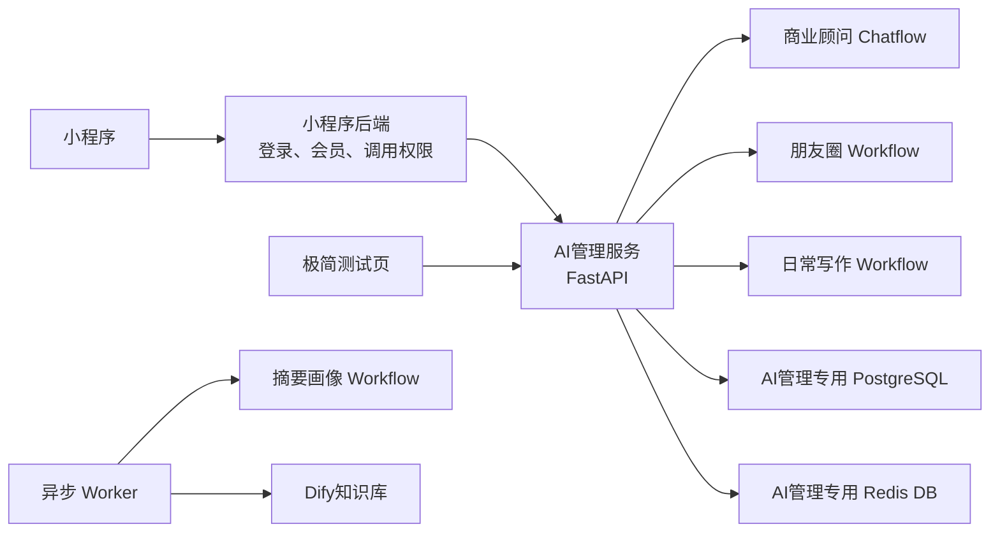
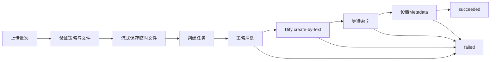
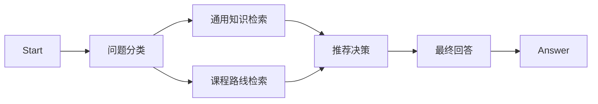

# AI 管理服务完整开发执行计划

> 本计划是开发依据，后续对话中已经确认的内容优先于旧附件和旧版计划。  
> 计划约束业务边界、数据流、接口和验收结果；GPT-5.6 可自行优化代码组织、类名、函数拆分和等价技术实现，不要求机械照搬示例结构。

## 1. 项目目标与成功标准

建设一个适合当前小项目的模块化 AI 管理服务，在15天左右完成开发、测试和灰度上线。

最终提供三个入口：

| 入口               | Dify 类型 | 主要能力                                             |
| ------------------ | --------- | ---------------------------------------------------- |
| `business_advisor` | Chatflow  | 商业问答、课程推荐、路线推荐、画像、摘要、多历史会话 |
| `moments_advisor`  | Workflow  | 朋友圈内容顾问，单次无状态运行                       |
| `writing_advisor`  | Workflow  | 日常写作，单次无状态运行                             |

同时建设一个内部 `summary_profile` Workflow，用于异步生成对话摘要、画像候选和路线进度候选。

成功标准：

- 三个入口均能通过小程序后端调用。
- 商业顾问支持流式回答、停止、历史、反馈和续聊。
- 长对话使用“摘要＋未摘要的最近消息”，不无限传入全部历史。
- 课程和路线只能来自已审核资料，不能产生错误链接和虚构路线。
- 批量文件能按选定策略清洗、写入知识库并返回逐文件成功或失败状态。
- 历史消息和会话按7天规则清理，画像保留。
- 复用 Dify 已有能力，不重复建设完整 AI 平台或运营后台。
- Redis、Dify 或 Worker 的局部故障不会造成核心业务事实丢失或文件永久卡在处理中。
- 首版能在20个并发 AI 流式请求下稳定运行；不把“小程序活动用户数”误认为同时生成请求数。

## 2. 已确认的边界和默认假设

### 2.1 最新决定

- 只有三个入口，不存在独立 `course_advisor`。
- 课程推荐属于商业顾问。
- 朋友圈和写作首版没有历史、摘要和用户画像。
- 小程序后端已经负责登录、会员和是否允许调用 AI。
- AI 管理服务不再重复实现会员鉴权，但保留内网访问控制和简单服务鉴权。
- 用户画像长期保留。
- 活跃对话中超过7天的原始消息删除，但摘要保留。
- 整个对话连续7天未活动时，删除对话、消息和摘要。
- 已确认的学习路线和进度作为用户级业务信息保留，除非用户主动清除。
- 清理任务凌晨执行，允许不足24小时的执行延迟。
- 清洗策略写在代码中，不建立策略表。
- 正式清洗策略等业务样本提供后再接入；首版先打通测试策略。
- 课程“学习结果”和一般“前置条件”不是必填字段。
- 路线的阶段和顺序表达标准学习先后关系；只有路线之外的特殊条件才单独记录。
- 不开发自定义的模型、Prompt、知识库管理后台，使用 Dify 控制台。
- Dify 原生反馈只用于商业顾问；Workflow 反馈不在首版范围。
- “1000万文本”默认理解为约1000万中文字符，不是1000万份文档或1000万个向量。

### 2.2 信息优先级

出现冲突时按以下顺序处理：

1. 本计划和后续最新确认。
2. 当前执行计划。
3. `用户操作和管理员操作部分场景.md`。
4. `背景介绍.txt`。
5. 较早的原型和附件描述。

实现过程中不得根据旧材料重新增加已取消的第四入口、朋友圈画像或复杂后台。

## 3. 总体架构

只建设一个模块化 AI 管理服务，不单独拆 AI 网关或微服务：



部署进程：

- `api`：FastAPI 服务。
- `worker`：摘要画像、文件清洗、点击落库和补偿任务。
- `scheduler`：凌晨清理和周期检查，可使用 Celery Beat 或等价轻量实现。
- `test-ui`：只在测试环境运行的极简 Streamlit 页面。

允许复用现有 PostgreSQL 和 Redis 实例，但必须使用独立数据库、Schema、Redis DB 或明确前缀，不得直接写 Dify 自身业务表和 Redis Key。

## 4. AI 管理服务内部模块

模块名称和目录结构不是强制要求，但职责必须保持清晰，避免把所有逻辑写进路由或 Dify 客户端。

### 4.1 配置模块

负责：

- 加载和校验环境变量。
- 区分开发、测试和生产环境。
- 管理 Dify 地址、四个 App Key、知识库 Key 和两个 Dataset ID。
- 管理数据库、Redis、内部 Token、保留天数、上传限制和摘要阈值。
- 启动时检查必需配置，缺失时明确报错。

不负责：

- 从代码中硬编码 API Key。
- 动态修改 Dify Chatflow 的知识库绑定。

### 4.2 内部鉴权与用户标识模块

负责：

- 校验 `X-Internal-Token`。
- 接收小程序后端传来的稳定用户 ID。
- 使用 HMAC 生成传给 Dify 的匿名 `user` 值。
- 生成日志使用的用户哈希，避免记录真实用户 ID。

边界：

- 不校验会员状态。
- 不决定用户是否有权调用 AI。
- 不从小程序登录凭证中重新解析用户身份。
- 同一 VPC 不视为充分鉴权；安全组和内部 Token 同时使用。

### 4.3 API 与 SSE 传输模块

负责：

- 参数校验。
- 统一 JSON 错误响应。
- 将 Dify SSE 转换为本系统 SSE。
- 处理客户端断开、停止生成和超时。
- 生成 `request_id`。
- 不把 Dify 原始内部异常和密钥返回给客户端。

统一错误结构：

```json
{
  "code": "DIFY_UNAVAILABLE",
  "message": "AI服务暂时不可用，请稍后重试",
  "request_id": "uuid",
  "retryable": true
}
```

主要错误码：

```text
UNAUTHORIZED
VALIDATION_ERROR
CONVERSATION_NOT_FOUND
CONVERSATION_BUSY
DIFY_UNAVAILABLE
DIFY_TIMEOUT
DIFY_RATE_LIMITED
DIFY_RESPONSE_INVALID
RECOMMENDATION_INVALID
CLEANING_FAILED
FILE_TOO_LARGE
UNSUPPORTED_FILE_TYPE
```

SSE 事件：

```text
request_started
status
answer_delta
retriever_resources
course_cards
learning_route
expert_insight
message_end
error
```

`status` 用于及时返回“正在检索资料”“正在生成学习路线”等状态，不需要等待模型首 Token。

### 4.4 Dify 集成模块

分成四类客户端，允许共享底层 HTTP/SSE 处理：

- 商业顾问 Chatflow 客户端。
- 朋友圈、写作 Workflow 客户端。
- 摘要画像 Workflow 客户端。
- 知识库 Service API 客户端。

负责：

- App 调用和 SSE 解码。
- 任务停止。
- 商业顾问反馈提交。
- 获取应用参数和预设问题。
- 会话删除。
- 知识库文档创建、更新、删除、状态轮询、Metadata 和检索测试。
- 将 Dify 错误映射为内部错误。

重试边界：

- 普通查询类 API 可短暂重试。
- 已经提交的聊天生成请求不得盲目自动重试，避免生成重复消息。
- 摘要、清洗和索引轮询任务允许有界重试。
- Dify 响应结构不符合预期时失败关闭，不猜测字段含义。

### 4.5 商业会话模块

负责：

- 本地逻辑会话的新建、列表、重命名和删除。
- 用户只能访问自己的会话。
- 本地消息持久化。
- 本地消息与 Dify 消息、任务和会话段的映射。
- 同一逻辑会话的并发锁。
- 生成失败、停止和断流状态。
- 自动生成首个会话标题，允许用户修改。

消息状态：

```text
pending
streaming
completed
stopped
failed
```

同一逻辑会话同一时刻只允许一个生成任务；第二个请求返回：

```text
409 CONVERSATION_BUSY
```

用户主动删除会话时：

- 立即删除本地会话、消息和摘要。
- 尝试删除所有 Dify 会话段。
- Dify 删除失败进入补偿任务。
- 不删除用户画像和其他路线进度。

### 4.6 Dify 会话分段模块

Dify 公开 API 不能删除一个会话中的指定消息，因此一个长期 Dify `conversation_id` 无法满足逐消息7天清理。

最终规则：

- 一个本地逻辑对话可以对应多个 Dify 会话段。
- 同一自然日内复用一个 Dify `conversation_id`。
- 跨自然日第一次继续对话时创建新段。
- 本地界面仍显示为一个历史对话。
- 新段通过动态 inputs 得到本地摘要、最近历史、画像和路线进度。

允许 Dify 中的数据比精确7天多保留不足24小时。若要求精确到分钟，需要改成每轮一个 Dify 会话或直接维护 Dify 数据库，首版不采用。

### 4.7 上下文构建模块

商业顾问关闭 Dify Memory，由服务统一构建上下文。

每轮 inputs：

```text
local_conversation_id
conversation_summary
recent_history_text
profile_json
route_progress_json
```

上下文优先级：

1. 系统 Prompt。
2. 用户确认画像。
3. 已确认路线进度。
4. 当前会话摘要。
5. 摘要游标之后的未摘要消息。
6. 当前用户问题。

规则：

- 摘要不能与已经覆盖的原始消息重复传入。
- 当前问题始终保留。
- 达到模型上下文预算时，优先删除最旧的未摘要消息，不删除画像和摘要。
- 超长输入执行可配置长度校验，避免单条内容直接撑满模型上下文。
- 实际 token 预算按所选模型能力设置，不在代码中硬编码某个模型的最大值。

开发前通过真实 Dify 1.13.3 验证同一 `conversation_id` 后续请求的普通 inputs 是否更新。源码表明每轮 inputs 会进入变量池，因此首选普通 inputs；只有实测失败才使用会话变量查询/更新 API。

### 4.8 摘要模块

触发条件满足任一即可：

- 未摘要内容达到6个用户轮次。
- 未摘要正文约6000个中文字符，作为约3000 token 的轻量近似。
- 凌晨清理将删除尚未进入摘要的消息。

处理流程：

1. 保存当前摘要和待摘要消息范围。
2. 异步调用摘要画像 Workflow。
3. 校验结构化输出。
4. 在短事务内更新摘要和 `summary_through_message_id`。
5. 更新前再次校验旧摘要和游标没有变化。
6. 游标已经前进时丢弃旧任务结果。

摘要失败：

- 正常聊天不受影响。
- Worker 按配置重试。
- 到达7天删除边界仍失败时，按数据保留要求删除原始消息并记录 `summary_gap`，不能无限延长原文保留时间。

### 4.9 用户画像模块

只维护商业画像。

最小信息：

```text
业务或学习目标
关注方向
经验或当前阶段
当前学习情况
时间、预算等明确约束
已确认路线
```

数据类型：

- `confirmed`：用户明确表达或明确确认。
- `candidate`：模型推断但用户没有确认。

规则：

- 明确事实可以更新确认画像。
- 模型推断不得覆盖确认事实。
- 冲突信息保留新旧证据，必要时在后续对话中确认。
- 明确查询某门课程不要求画像完整。
- 路线推荐只询问会改变推荐结果的信息，一次最多两个问题。
- 删除历史对话不删除画像。
- 首版不建设复杂画像标签平台、画像运营后台或朋友圈/写作画像。

### 4.10 课程目录模块

负责：

- 解析老板模板格式的课程 Markdown。
- 校验课程和路线数据。
- 生成或保留稳定课程 ID、路线 ID。
- 写入 Dify 课程知识库。
- 写入 PostgreSQL。
- 生成 Redis 当前快照。
- 提供课程、路线和官方链接查询。
- 管理启用和审核状态。

课程必填：

```text
course_id
课程名称
所属方向
主要内容或解决的问题
官方跳转链接
```

首次测试资料缺少 `course_id` 时由导入程序生成；正式资料后续更新必须沿用稳定 ID。

系统字段：

```text
enabled
review_status
source_file
updated_at
```

可选：

```text
适合人群
课程重点
学习结果
特殊前置条件
阶段标签
```

“学习结果”只能描述课程预期帮助，不能成为效果承诺。缺失时仍可推荐。“特殊前置条件”仅用于路线之外确实存在的强制要求。

### 4.11 课程和路线导入模块

首版使用内部 CLI，不开发课程管理后台和发布批次 API。

命令能力：

```text
dry-run：只校验并输出错误
publish：正式写入
```

发布顺序：

1. 解析课程和路线 Markdown。
2. 校验必填字段、重复 ID、重复链接和路线引用。
3. 生成标准化课程/路线知识库文本。
4. 写入或更新 Dify 测试课程知识库。
5. 等待索引完成并确认分块数大于0。
6. 在数据库事务中更新课程和路线事实。
7. 构建临时 Redis 快照并原子替换当前快照。
8. 将不再启用的课程标记为停用，不能仅从 Redis 删除后继续让服务输出。

Dify 更新失败时不发布数据库新数据。Dify 中提前出现的新课程，也会因数据库和 Redis 尚未批准而被推荐校验层过滤。

如果未来需要后台上传课程资料，可复用同一导入服务封装接口，不重写导入逻辑。

### 4.12 推荐决策模块

商业顾问支持四种决策：

```text
general_qa
direct_course
route_recommendation
clarification
```

行为：

- 明确查询课程：直接检索，不强制画像补全。
- 用户表达目标但不知道学什么：结合确认画像查找已审核路线。
- 信息不足：最多追问两个会实质改变路线的问题。
- 没有正式路线：只能推荐单门课程，不生成“官方路线”。
- 用户有多条路线：根据当前需求选择相关路线，不覆盖其他路线。
- 当前阶段完成后，只有用户明确确认才能进入下一阶段。
- 课程卡片点击不代表学习完成。
- 首版不记录每门课程、每节课或视频时间点进度。

Chatflow 内部候选输出：

```json
{
  "intent": "route_recommendation",
  "candidate_course_ids": ["course_001"],
  "candidate_route_id": "route_ai_001",
  "missing_information": [],
  "clarification_question": "",
  "answer_plan": "",
  "expert_insight": "",
  "progress_action": {
    "type": "none",
    "route_id": "",
    "stage_id": "",
    "evidence_quote": ""
  }
}
```

服务对候选执行最终校验：

- ID 存在。
- `enabled=true`。
- `review_status=approved`。
- 路线和阶段引用有效。
- 课程属于允许推荐的当前阶段。
- 链接来自课程事实表。
- 进度操作中的证据片段能在当前用户输入中找到。

模型正文不得输出原始课程链接和自行组织的正式路线表。最终课程卡片、路线和阶段数据由服务从 Redis 快照生成。

候选 JSON 解析失败时：

- 可以保留有依据的一般问答。
- 不返回课程卡片、路线或进度修改。
- 记录结构化输出错误供调试。

### 4.13 学习路线进度模块

允许用户同时保存多条路线。

最小记录：

```text
user_id
route_id
current_stage_id
status
confirmed_at
updated_at
```

首版状态：

```text
active
completed
paused
```

规则：

- 一个阶段中的课程视为该阶段学习清单。
- 不逐门自动追踪完成情况。
- 用户可以自然语言明确确认当前阶段已经完成。
- 只有服务验证路线、阶段和当前顺序后才推进。
- 跳过阶段时需要用户明确表达，不能由模型自行判断。
- AI 不得创建不存在的路线、阶段或顺序。

### 4.14 点击统计模块

课程卡片不直接返回第三方链接，而返回站内签名链接：

```text
/r/{signed_token}
```

Token 至少绑定：

```text
course_id
user_hash
签发时间或有效期
```

跳转流程：

1. 校验 Token。
2. 从 Redis 或数据库读取当前启用课程和正式链接。
3. Redis 增加总点击次数。
4. 将用户哈希加入课程/日期集合，用于计算独立点击人数。
5. `302` 跳转到当前正式链接。
6. 凌晨批量写入课程日汇总表。

点击是统计数据，允许 Redis 故障造成少量损失；不为点击引入每次数据库事务、Outbox 或复杂事件平台。

提供只读统计接口，返回：

- 课程。
- 日期范围。
- 点击次数。
- 独立点击人数。

### 4.15 朋友圈和写作模块

负责：

- 输入校验。
- 调用对应 Dify Workflow。
- 转换流式事件。
- 停止任务。
- 返回 Token 和耗时信息。

不负责：

- 创建历史会话。
- 保存业务消息正文。
- 生成摘要。
- 更新用户画像。
- 推荐课程。
- 保存 Dify 反馈。

Dify 本身仍可能保存 Workflow 运行日志。首版的7天历史清理只针对商业顾问；如果7天是合规性要求而不只是产品历史要求，需要另行验证 Dify Workflow 日志清理配置。

### 4.16 高频问题模块

优先复用 Dify 应用的开场白和推荐问题能力。

`GET /internal/v1/entry-config` 聚合返回：

- 三个入口名称和说明。
- 开场白。
- 3～10个推荐问题。
- 当前入口是否支持历史、反馈和课程推荐。

不建立高频问题数据库或运营后台。管理员在 Dify 中调整应用开场和推荐问题，服务可以进行短时间缓存。

### 4.17 清洗策略模块

策略只注册在代码中：

```python
STRATEGY_REGISTRY = {
    "test_markdown": TestMarkdownStrategy(),
    "personal_business_consultation": PersonalBusinessConsultationStrategy(),
}
```

策略最小接口：

```python
class CleaningStrategy:
    code: str
    display_name: str
    supported_extensions: set[str]

    def clean(file_path, original_filename) -> list[CleanedDocument]:
        ...
```

`CleanedDocument`包含：

```text
Markdown正文
标题
Metadata
父块分隔符和最大长度
子块分隔符和最大长度
```

允许一个原文件生成多个 Dify 文档。

不建设：

- 清洗策略表。
- 策略增删改查接口。
- 动态策略脚本上传。
- 通用 ETL 平台。
- 策略版本表。

日志记录应用 `build_version` 或 Git 提交号，用于判断某次任务使用的代码版本。

### 4.18 批量清洗编排模块

上传接口一次选择一个策略和一个目标知识库，上传多个文件。

流程：



文件状态：

```text
pending
processing
succeeded
failed
```

阶段：

```text
upload
cleaning
dify_upload
dify_indexing
metadata
```

规则：

- 一个文件失败不回滚其他文件。
- 不支持的格式只使对应文件失败。
- 任一步失败都保存阶段、错误码和可读错误。
- 一个原文件拆出的全部 Dify 文档成功后，该文件才成功。
- Dify HTTP 创建成功不代表入库成功。
- 必须等待索引 `completed`、确认分块数大于0并设置 Metadata。
- 创建成功后立即保存 Dify 文档 ID。
- 重试时从可恢复阶段继续。
- 索引失败需要删除或停用残留文档后再创建。
- 部分文档成功、部分失败时删除或停用已成功部分，避免脏内容进入检索。
- Worker 异常自动重试一次，第二次失败进入终态。
- 长时间 `processing` 的任务使用任务租约或心跳识别，但不建立复杂分布式工作流平台。

批次状态：

```text
processing：仍有文件未进入终态
completed：全部文件已经succeeded或failed
```

`completed` 不代表全部成功，另外返回 `all_succeeded`。

### 4.19 文件名称和来源追踪模块

保留三个名称。

原始名称：

```text
original_filename
```

- 保存完整规范化文件名。
- 只用于状态展示和内部追踪。
- 不用作磁盘名称或 Redis Key。

服务器名称：

```text
{file_id}.{原扩展名}
```

Dify 名称：

```text
{缩短后的主名}__{SHA256前8位}__{序号}.md
```

处理规则：

- 去除路径和控制字符。
- 合并连续空格。
- 主文件名最长60个字符。
- 超长时保留开头和结尾，中间用省略号。
- 敏感策略使用匿名文档名。

Metadata：

```text
source_file_id
source_filename
source_extension
source_sha256
upload_batch_id
cleaning_strategy
document_type
review_status
course_id
route_id
direction
```

调用方的公共 Metadata 只能添加允许字段，不能覆盖系统来源字段。

### 4.20 定时任务和数据清理模块

每天凌晨 `03:30 Asia/Shanghai` 执行：

1. 清理活跃对话中超过7天的原始消息。
2. 删除连续7天未活动的完整逻辑对话和摘要。
3. 删除已经全部过期的 Dify 会话段。
4. 重试之前失败的 Dify 会话删除任务。
5. 批量写入点击日统计。
6. 清理过期的成功和失败临时文件。
7. 将长时间卡住的清洗任务重试一次或改为失败。

并发规则：

- 清理逻辑会话前获取短期 Redis 锁。
- 正在生成中的会话跳过并在10分钟后重试。
- 不在数据库长事务中调用 Dify。
- 删除数据库数据和调用 Dify 分开处理。
- Dify 删除失败不能阻塞本地7天删除。

### 4.21 PostgreSQL 持久化模块

最小表：

- `business_profile`
- `business_conversation`
- `business_conversation_segment`
- `business_message`
- `learning_route_progress`
- `course`
- `learning_route`
- `course_click_daily`
- `cleaning_batch`
- `cleaning_file`
- `cleaning_document`
- `external_deletion_task`，只用于记录失败的 Dify 删除补偿；若实现采用已有任务存储达到同等效果，可不单独建表。

关键要求：

- `business_message`必须保存角色、内容、状态、时间、Dify message/task ID、Token、耗时和推荐结果。
- 摘要可保存在 `business_conversation`，不强制单建摘要表。
- 灵活画像和路线详情可使用 JSONB，避免为少量字段建立大量表。
- 数据库迁移可重复执行并支持新环境初始化。
- 不建反馈表、清洗策略表、课程版本表和 Outbox 表。

### 4.22 Redis 模块

Redis 用途：

- 用户画像和摘要缓存。
- 路线进度缓存。
- 当前课程快照。
- 同一对话生成锁。
- 清洗中间状态。
- Worker 队列。
- 点击计数和独立用户集合。
- 少量应用参数缓存。

一致性：

- 画像、摘要和路线进度先写 PostgreSQL，再更新或删除缓存。
- 课程发布后使用临时 Key 构建完整快照并原子替换。
- 读取缓存失败或缓存不存在时回源 PostgreSQL。
- 不维护缓存数据版本、人工回退和5分钟重建巡检。
- Redis RDB/AOF 不能被当作核心事实的唯一持久化。
- 点击统计是允许少量误差的例外。

### 4.23 管理查询和可观测性模块

首版提供只读管理接口：

- 查询逻辑对话列表。
- 查询完整逻辑对话和消息。
- 查看问题、回答、推荐课程、专家见解、Token 和耗时。
- 查询课程点击统计。
- 查询清洗批次和失败原因。

模型、Prompt、知识库管理继续使用 Dify 控制台。

日志字段：

```text
request_id
user_hash
entry
local_conversation_id
dify_conversation_id
dify_message_id
task_id
first_token_ms
total_ms
token_usage
retrieval_count
recommended_course_ids
recommended_route_id
cleaning_stage
error_code
```

默认不记录完整问题、回答、用户真实 ID、敏感文件名和 API Key。

健康检查：

- `live`：进程存活。
- `ready`：关键配置、PostgreSQL 和 Redis 可用。
- Dify 短暂不可用不必让进程失活，但 `ready` 或诊断信息应能反映。

### 4.24 极简测试页

新建 Streamlit 测试页，只调用 AI 管理服务，不直连 Dify。

页面包含：

1. 商业顾问：
   - 新建和选择历史对话。
   - 续聊、重命名、删除。
   - 流式输出、停止和反馈。
   - 查看课程卡片、路线、引用和专家见解。
2. 朋友圈顾问：
   - 单次运行、停止和耗时。
3. 日常写作：
   - 单次运行、停止和耗时。
4. 课程测试：
   - 显示测试课程和路线数据。
   - 执行典型推荐问题。
5. 文件清洗：
   - 查看策略。
   - 批量上传。
   - 轮询状态。
   - 查看失败阶段和重试。
6. 诊断：
   - request ID。
   - 本地/Dify 会话和任务 ID。
   - 首 Token、总耗时、Token 用量。
   - 推荐校验结果和错误信息。

测试页不是正式运营后台，不投入复杂 UI 工作。

## 5. Dify 应用和 DSL

需要生成并保存四份 DSL：

```text
商业顾问 Chatflow
朋友圈顾问 Workflow
日常写作 Workflow
摘要画像 Workflow
```

共同要求：

- Dify 1.13.3 DSL `0.6.0`。
- 默认使用当前环境可用的通义千问模型，首选 `qwen-plus`。
- 不在 DSL 中保存 API Key。
- Prompt 单独保存 Markdown 文档。
- 导入后通过 Dify 控制台检查模型依赖、变量和知识库绑定。
- DSL 导入成功不代表发布成功，必须执行一次真实 API 调用。

### 5.1 商业顾问 Chatflow 节点职责

推荐流程：



可根据 Dify 画布限制调整具体分支，但必须达到：

- 综合问题能同时使用通用和课程资料。
- 课程候选输出为结构化 ID。
- 最终正文不直接生成正式课程链接。
- 没有检索证据时明确说明资料不足。
- 路线和课程卡片由服务最终校验。
- `node_finished` 中能取得推荐决策结构，供服务解析。
- 召回结果通过 `retriever_resources` 转发给客户端。

### 5.2 朋友圈和写作 Workflow

根据场景文档编写 Prompt 和输入字段，输出清晰正文。

首版保持简单：

- 一个开始节点。
- 必要的输入整理。
- 一个主要 LLM 节点。
- 一个结束节点。
- 只有确有业务价值时才增加条件或代码节点。

### 5.3 摘要画像 Workflow

要求：

- 输入旧摘要和新的消息范围。
- 输出严格结构化 JSON。
- 不生成最终用户回答。
- 不自行写数据库。
- 不覆盖用户已确认但没有新证据否定的事实。
- 失败时返回明确错误，由 Worker 决定重试。

## 6. 知识库设计与创建步骤

建立两个测试知识库：

### `business-general-test`

内容：

- 商业知识。
- 公众号文章。
- 业务案例。
- SOP。
- 课程讲义、字幕或知识型内容。
- 一般常见问答。

### `business-course-test`

内容：

- 已审核课程目录。
- 课程详情。
- 标准学习路线。
- 路线阶段和课程引用。

创建步骤：

1. 在 Dify 创建两个空知识库。
2. 使用同一种可用的中文 Embedding 模型。
3. 首版使用高质量索引和普通向量检索；没有现成 Rerank 模型时不为规范强行增加。
4. 在知识库 Service API 页面生成 API Key。
5. 将两个 Dataset ID 和知识库 Key 配置到 AI 服务环境变量。
6. 导入测试课程、路线和通用资料。
7. 在商业顾问 Chatflow 中手动绑定两个知识库。
8. 发布 Chatflow。
9. 分别进行检索测试和完整 Chatflow 测试。

Dataset ID 环境变量不会自动改变 Dify 原生知识检索节点绑定。更换知识库时必须修改环境变量、重新绑定 Chatflow 节点并发布。

## 7. 测试课程和路线资料

依据老板 DOCX 模板生成本地测试数据：

- 8门启用课程。
- 1门停用课程。
- AI基础应用路线。
- 公众号运营路线。
- 每条路线包含入门、进阶和实战阶段。
- 每阶段引用真实测试课程 ID。
- 部分课程包含学习结果、适合人群和特殊前置条件。
- 部分课程故意缺少这些可选字段。
- 准备错误样本：重复 ID、无链接、引用不存在课程和路线顺序错误。

同时生成预期结构 JSON，用于验证导入结果、路线结构、课程状态和推荐输出。

## 8. 接口清单

### 8.1 商业顾问

```http
POST   /internal/v1/business/chat
POST   /internal/v1/business/chat/{task_id}/stop
GET    /internal/v1/business/conversations
GET    /internal/v1/business/conversations/{conversation_id}/messages
PATCH  /internal/v1/business/conversations/{conversation_id}
DELETE /internal/v1/business/conversations/{conversation_id}
POST   /internal/v1/business/messages/{message_id}/feedback
```

`POST /business/chat`：

- 不传本地会话 ID时创建新对话。
- 传入时验证归属并续聊。
- 返回 SSE。
- 不允许调用者直接传 Dify `conversation_id`。
- 不接受调用者覆盖画像、摘要和路线进度。

### 8.2 无状态工具

```http
POST /internal/v1/tools/moments/run
POST /internal/v1/tools/writing/run
POST /internal/v1/tools/{task_id}/stop
```

不返回商业逻辑会话 ID、课程和路线事件。

### 8.3 首页和点击

```http
GET /internal/v1/entry-config
GET /r/{signed_token}
```

### 8.4 文件清洗

```http
GET  /internal/v1/knowledge/cleaning-strategies
POST /internal/v1/knowledge/cleaning-batches
GET  /internal/v1/knowledge/cleaning-batches/{batch_id}
POST /internal/v1/knowledge/cleaning-batches/{batch_id}/files/{file_id}/retry
```

上传参数：

```text
strategy_code
knowledge_base_code
files[]
可选公共Metadata
```

`knowledge_base_code`映射到服务端允许的 Dataset ID，调用方不能直接传任意 Dify Dataset ID。

### 8.5 只读管理

```http
GET /internal/v1/admin/conversations
GET /internal/v1/admin/conversations/{conversation_id}
GET /internal/v1/admin/course-clicks
```

### 8.6 健康检查

```http
GET /health/live
GET /health/ready
```

## 9. 环境变量

至少包含：

```text
APP_ENV
INTERNAL_API_TOKEN
USER_HMAC_SECRET

DATABASE_URL
REDIS_URL

DIFY_BASE_URL
DIFY_BUSINESS_APP_API_KEY
DIFY_MOMENTS_APP_API_KEY
DIFY_WRITING_APP_API_KEY
DIFY_SUMMARY_PROFILE_APP_API_KEY

DIFY_KNOWLEDGE_BASE_URL
DIFY_KNOWLEDGE_API_KEY
DIFY_GENERAL_DATASET_ID
DIFY_COURSE_DATASET_ID

HISTORY_RETENTION_DAYS=7
CLEANUP_TIME=03:30
SUMMARY_USER_TURNS=6
SUMMARY_APPROX_CHARS=6000

MAX_UPLOAD_FILE_MB=200
MAX_UPLOAD_FILES=10
MAX_UPLOAD_BATCH_MB=500
FAILED_FILE_RETENTION_HOURS=24
CLEANING_STATUS_RETENTION_DAYS=7
```

具体变量名允许实现时合理统一，但必须提供完整 `.env.example`、启动校验和中文配置说明。

## 10. 测试计划

### 10.1 单元测试

覆盖：

- Dify SSE 分片、多个事件和异常事件。
- 统一错误转换。
- HMAC 用户标识。
- 同一对话锁。
- 摘要触发和游标覆盖保护。
- 上下文顺序和长度预算。
- 画像确认与候选合并。
- 课程和路线导入校验。
- 停用课程过滤。
- 路线阶段推进。
- 跳转 Token。
- 文件名缩短和非法字符。
- 策略注册和格式检查。
- 批次状态汇总。
- 清洗重试和远程残留补偿。
- 7天清理边界。

### 10.2 Dify 1.13.3 契约测试

必须连接实际部署验证：

- 后续普通 inputs 是否更新。
- 会话变量备用 API。
- 流式 Chatflow。
- 停止生成。
- 消息反馈。
- 会话删除。
- 三个 Workflow。
- 四份 DSL 导入和发布。
- 两个知识库检索。
- 父子分段。
- Metadata。
- 索引状态。
- 零分块。
- 中文和超长文档名称。

### 10.3 商业业务测试

- 多用户不串画像、消息和推荐。
- 一个用户多个历史对话不串摘要。
- 跨日生成新的 Dify 会话段但本地续聊正常。
- 摘要覆盖以前内容且不重复传入。
- 明确查询课程不追问无关画像。
- 模糊目标只追问必要问题。
- 没有正式路线时不生成官方路线。
- 停用课程不出现在卡片。
- 模型生成错误 ID 或链接时被服务拦截。
- 用户没有明确确认时不推进阶段。
- 点击只统计，不改变学习进度。
- 删除历史对话后画像仍存在。
- 活跃对话只删除7天前原始消息并保留摘要。
- 闲置7天会话连同摘要删除。

### 10.4 清洗测试

- 多文件全部成功。
- 部分成功、部分失败。
- 不支持的扩展名。
- 超大文件。
- 重名文件。
- 超长和中文文件名。
- 一个文件拆成多个文档。
- Dify 创建失败。
- HTTP创建成功但索引失败。
- 索引完成但零分块。
- Metadata 失败。
- Worker 中断。
- 自动重试一次。
- 手动重试失败文件。
- 残留文档不会进入有效检索结果。
- 敏感文件名和隐私信息不会进入 Dify。

### 10.5 RAG 评测

使用现有评测函数和轻量 JSONL 测试集，不引入完整 Ragas 服务。

黄金问题至少40条：

- 10条一般商业问答。
- 10条精确课程查询。
- 10条路线和阶段问题。
- 10条无答案、歧义或诱导编造问题。

门槛：

```text
关键问题 Hit@5 >= 90%
全量 Recall@5 >= 80%
引用完整率 >= 90%
无依据回答率 <= 5%
错误课程ID = 0
错误正式链接 = 0
虚构路线 = 0
```

自动指标之外，人工检查至少10条完整回答，重点检查是否答非所问、引用不支撑结论和专业见解夸大。

### 10.6 并发和故障测试

- 20个并发流式 AI 请求持续10分钟。
- 同一会话并发稳定返回409。
- 客户端中途断开。
- Dify超时、限流和不可用。
- Redis短暂不可用。
- PostgreSQL短暂不可用。
- Worker重启。
- 200MB文件流式上传。
- OCR并发固定1时聊天接口仍能响应。
- AI 管理服务自身增加的首段响应开销目标 `p95 < 200ms`，不包含模型生成时间。

不承诺支持5000个同时生成请求。上线前记录模型供应商实际 RPM、TPM 和并发额度，并根据活动期间真实 AI 使用比例调整。

## 11. 开发交付物

### 11.1 文档

- 完整需求说明。
- 产品流程和边界说明。
- 服务开发说明。
- API文档和SSE事件说明。
- 数据库和缓存说明。
- Dify创建、导入、绑定和发布指南。
- Prompt设计文档。
- 清洗策略接入说明。
- 测试计划和验收报告。
- 部署、备份、回滚和常见故障说明。
- 更新后的主执行计划。

### 11.2 Dify 文件

- 商业顾问 Chatflow DSL。
- 朋友圈 Workflow DSL。
- 日常写作 Workflow DSL。
- 摘要画像 Workflow DSL。
- 四份 Prompt 文档。
- 两个知识库创建和绑定说明。

### 11.3 测试资料

- 测试课程 Markdown。
- 测试路线 Markdown。
- 课程和路线预期 JSON。
- 通用知识库测试 Markdown。
- RAG 黄金问题 JSONL。
- 清洗测试样本和预期结果。

### 11.4 服务文件

- 可运行的 AI 管理服务。
- Worker 和定时任务。
- 数据库迁移。
- `.env.example`。
- Dockerfile 和独立部署 Compose。
- 极简 Streamlit 测试页。
- 自动测试和测试命令。
- 课程导入 CLI。

内部目录、类名和函数名由 GPT-5.6 根据实现需要决定，不要求为了形式建立大量空层或无业务价值的抽象。

## 12. 15天开发顺序和阶段门禁

### 第1天：基线和文档

- 将最新决定同步进需求、产品、开发、API、Prompt 和测试文档。
- 建立 Git 基线，保护当前未提交文件。
- 增加依赖、环境变量示例、迁移和部署骨架。
- 更换已经用于本地测试的 Dify Key。
- 确认两个知识库和四个应用的创建步骤。

门禁：需求边界、三入口、数据保留和课程字段不得再有冲突。

### 第2天：Dify契约和DSL

- 创建两个测试知识库。
- 创建四个 Dify 应用。
- 导入并修正四份 DSL。
- 完成 inputs、流式、停止、反馈、索引和 Metadata 契约测试。

门禁：商业顾问真实 API 调用和知识检索必须成功，否则不进入主服务开发。

### 第3～4天：服务骨架

- FastAPI、配置、内部 Token。
- PostgreSQL、Redis、迁移。
- Worker、定时任务。
- Dify客户端、SSE和统一错误。
- 健康检查和基础日志。

门禁：服务可启动、配置错误明确、数据库迁移和测试稳定。

### 第5～6天：商业顾问基础链路

- 本地会话和消息。
- 每日 Dify 会话段。
- 流式、停止、断流和反馈。
- 会话列表、续聊、重命名和删除。
- 同一会话锁。

门禁：多用户、多会话、跨日续聊和停止测试通过。

### 第7天：摘要、画像和清理

- 上下文构建。
- 摘要画像 Workflow 接入。
- 摘要游标。
- 画像合并。
- 凌晨7天清理和 Dify 删除补偿。

门禁：摘要不重复、旧任务不覆盖新摘要，删除规则符合确认要求。

### 第8～9天：课程和路线

- 测试课程及路线资料。
- 导入 CLI。
- Dify课程知识库。
- 课程Redis快照。
- 直接推荐、路线推荐、卡片和进度。
- 错误候选过滤。
- 点击统计。

门禁：错误课程ID、错误链接和虚构路线全部为0。

### 第10天：朋友圈、写作和入口配置

- 两个无状态 Workflow。
- 停止任务。
- 推荐问题和入口配置。
- 只读管理查询。

门禁：无状态入口不会建立商业历史和画像。

### 第11～12天：批量清洗

- 策略接口和注册表。
- 测试策略及基础DOCX适配。
- 批量上传、状态和重试。
- Dify索引、Metadata和补偿。
- 极简测试页。

门禁：每个文件最终进入成功或失败，不能永久卡住或产生有效脏文档。

### 第13天：RAG和业务回归

- 40条黄金问题。
- 检索指标。
- 完整回答检查。
- 课程、路线、画像和摘要回归。

### 第14天：异常和压力测试

- 20并发。
- Redis、数据库、Dify和Worker故障。
- 大文件和OCR。
- 7天清理模拟。
- 修复阻塞问题。

### 第15天：灰度上线

- 配置检查。
- 数据库备份。
- Dify应用和知识库发布确认。
- 小比例真实用户灰度。
- 观察错误率、首Token、总耗时、Token、召回和课程点击。
- 通过后逐步放量。

若正式清洗策略样本尚未提供，只交付已经验证的测试策略、现有咨询策略和策略接入位置，不临时猜测业务清洗规则。

## 13. 最终验收清单

- 只有三个入口。
- 商业顾问是唯一包含课程推荐的入口。
- 四份 Dify DSL 均能在1.13.3导入、发布和调用。
- 两个知识库完成创建、导入、绑定和检索测试。
- 小程序只调用 AI 管理服务，不接触 Dify Key。
- 商业顾问历史、摘要、画像和路线不串用户。
- Dify Memory 关闭，服务上下文没有重复历史。
- 同一逻辑对话可以跨多个 Dify 每日会话段续聊。
- 活跃对话删除7天前原始消息并保留摘要。
- 闲置7天对话连同摘要删除。
- 用户画像不会随历史对话删除。
- 明确课程查询不强制画像补全。
- 课程学习结果和一般前置条件不是必填。
- 路线、阶段和课程顺序只能来自审核资料。
- 所有正式课程链接都来自结构化课程表。
- 停用课程不生成卡片。
- 点击不会被当作学习完成。
- Dify原生反馈只用于商业顾问，没有重复反馈表。
- 朋友圈和写作没有本地历史和画像。
- 清洗策略不存在数据库定义。
- 一个批次只能选择一种策略。
- 重名和超长文件不会覆盖。
- 原始文件来源可追踪。
- 所有清洗文件最终进入成功或失败。
- 索引失败、零分块和Metadata失败都不能算成功。
- Worker异常不会让任务永久停在处理中。
- Redis不是画像、摘要、路线和课程事实的唯一存储。
- 20个并发流式请求下无串流、死锁和任务泄漏。
- RAG指标和防课程幻觉门槛通过。
- Dify、PostgreSQL和临时文件具备备份与恢复说明。

## 14. 第一版明确不做

- 独立 AI 网关微服务。
- 微服务拆分。
- 完整自定义 AI 管理后台。
- 自研模型、Prompt管理平台或RAG平台。
- 清洗策略数据库和动态插件平台。
- 朋友圈/写作历史、画像和反馈。
- 商业对话附件上传；清洗上传是独立入口。
- AI 自动创建和发布正式课程或路线。
- AI 自动判断用户学完课程。
- 每门课、每节课和视频时间点进度。
- 精确到分钟的 Dify 单消息删除。
- 复杂缓存版本、人工回退、Outbox和5分钟巡检。
- 为点击统计建设消息队列或事件平台。
- 为少量只读管理功能建设复杂前端。
- 5000个同时生成请求的容量承诺。
- 在没有真实清洗样本时设计“万能清洗器”。

## 15. 主要事实依据

- Dify 1.13.3 提供整段会话删除、会话变量查询和更新，但公开服务 API 没有指定消息删除接口，因此采用本地历史和每日 Dify 会话分段。[Dify 1.13.3会话API源码](https://github.com/langgenius/dify/blob/1.13.3/api/controllers/service_api/app/conversation.py)
- Dify 1.13.3 Advanced Chat Runner 会把本次请求的 inputs 放入运行变量池，因此优先实测并使用每轮动态 inputs，而不是预设其必然失效。[Dify Advanced Chat Runner](https://github.com/langgenius/dify/blob/1.13.3/api/core/app/apps/advanced_chat/app_runner.py)
- 当前应用 DSL 版本为 `0.6.0`。[Dify 1.13.3 DSL源码](https://github.com/langgenius/dify/blob/1.13.3/api/services/app_dsl_service.py)
- Dify App Key 按应用隔离；知识库 API Key 可以访问创建账号可见的多个知识库，因此需要四个 App Key 和一个知识库 Key。[Dify API说明](https://docs.dify.ai/en/api-reference/guides/get-started.md)
- Dify 文档创建和索引是异步过程，必须轮询到 `completed` 或 `error`，HTTP创建成功不能视为入库完成。[Dify索引状态文档](https://docs.dify.ai/en/api-reference/documents/get-document-indexing-status.md)
- 当前工作区只有部分清洗器和基础 Dify 客户端，没有完整 AI 管理服务、Worker、部署文件和可编辑测试页，因此本计划按“复用已有清洗能力并新建模块化服务骨架”估算，而不是按已有完整项目改造估算。