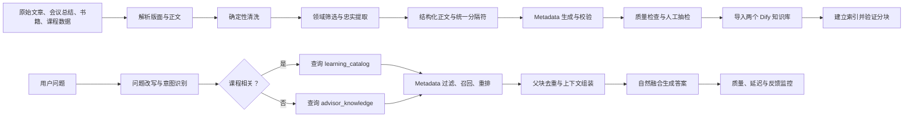

# AI 商业顾问 RAG 全链路执行计划

## 一、目标、结论与依据

### 最终目标

建立一个以“商业诊断、决策、案例借鉴、课程与学习路线推荐”为核心的 AI 商业顾问系统，同时兼容普通通用问题。

系统不是原文资料库，而是面向最终问答效果的知识系统。因此：

- 认知分享、书籍只提取直接商业知识和可迁移决策认知。
- 咨询会议总结作为完整案例保留，不能把方案拆离背景和约束。
- 课程、学习路线与顾问知识使用两个独立 Dify 知识库。
- 用户问题先改写和识别，再只查询一个目标知识库。
- metadata 必须用于查询过滤、父块关联、去重或来源展示，不保留装饰性字段。
- 无有效知识命中时，由基础模型回答，不能强行拼接低相关内容。

### 两个知识库

1. `advisor_knowledge`
   - 认知分享
   - 咨询会议案例
   - 书籍商业知识

2. `learning_catalog`
   - 课程信息
   - 学习路线
   - 课程推荐依据

该拆分依据是检索行为不同：

- 顾问问答需要语义、论证、案例和适用条件。
- 课程查询需要 `level`、`audience`、`status` 等精确过滤。
- 不按公众号、书籍、会议等来源继续拆库，避免管理和路由复杂化。
- 普通请求只查询一个库，因此两个库不会天然降低速度；真正增加延迟的是每次都同时查询多个库。

[Pinecone 官方文档](https://docs.pinecone.io/guides/index-data/implement-multitenancy)建议不同检索负载使用不同索引；[Qdrant](https://qdrant.tech/documentation/manage-data/indexing/)说明 metadata/payload 索引可以提高过滤查询效率，但只应为实际过滤字段建立索引。

### 技术依据与适用边界

事实依据：

- [Haystack DocumentCleaner](https://docs.haystack.deepset.ai/docs/documentcleaner)主要处理空白、Unicode、页眉页脚和重复字符串，说明“清洗”不等于全文摘要。
- [Unstructured](https://docs.unstructured.io/open-source/core-functionality/chunking)先识别标题、正文、列表、表格等语义元素，再按结构分块。
- [Docling](https://github.com/docling-project/docling)重点处理版面、阅读顺序、表格和 OCR。
- [LangChain ParentDocumentRetriever](https://reference.langchain.com/python/langchain-classic/retrievers/parent_document_retriever/ParentDocumentRetriever)采用小块检索、父文档返回，解决检索精度与上下文完整性的冲突。
- Dify 检索节点能够解析变量并生成 metadata 条件，见 [knowledge_retrieval_node.py](https://github.com/langgenius/dify/blob/main/api/core/workflow/nodes/knowledge_retrieval/knowledge_retrieval_node.py)。

需要明确的推论和建议：

- “只提取商业相关内容”不是所有 RAG 的通用最佳实践，而是根据本系统垂直定位作出的产品选择。
- `<<<DIFY_PARENT>>>` 和 `<<<DIFY_CHILD>>>` 不是行业标准；价值在于固定、清晰、低碰撞和可验证。
- 子块大小不存在通用最优值，以下参数是启动值，最终必须由真实问题测试确定。
- Dify 不同版本、文件解析器和向量数据库可能存在父子分块或 metadata 过滤差异，上线前必须在实际部署版本验证。

## 二、全链路流程



实施阶段：

1. 环境与版本预检。
2. 数据解析和清洗。
3. 结构化与父子分块。
4. Metadata 生成。
5. Dify 导入与索引。
6. 查询改写和路由。
7. 检索、父块去重与答案生成。
8. 评测、灰度发布和监控。
9. 原文件删除与清洗版本留存。

## 三、数据清洗总原则

### 允许删除

- “嗯、啊、就是说”等无语义填充词。
- 无信息增量的口头重复。
- 寒暄、会务说明、平台互动、广告和引流。
- 重复页眉、页脚、页码和目录正文。
- 明确的 OCR 错字、乱码、错误断行。
- 与商业判断没有迁移关系的主要内容。
- 咨询材料中的姓名、电话、邮箱、公司机密等敏感信息。

### 必须保留

- 数字、时间、主体和对象。
- 否定关系与程度差异。
- 因果链和论证过程。
- “可能、通常、只适合、除非”等限制。
- 自我修正后的最终观点。
- 反例、失败经验和风险。
- 案例背景、约束、诊断、方案和结果之间的对应关系。
- 计划结果与已经发生的实际结果之间的区别。
- 作者观点、客户事实和顾问判断之间的区别。

### 禁止行为

- 不得为了文字流畅改变事实或结论。
- 不得把模型推断写成原文事实。
- 不得为了填满结构字段编造内容。
- 不得把不同文章或案例合并成一个“更完整”的案例。
- 不得把咨询方案拆离其案例背景后单独作为通用答案。
- 不得在清洗阶段直接总结整篇长文并用摘要替代知识正文。

## 四、各类数据的处理规范

### 4.1 认知分享：公众号、来信、帖子等

采用两遍处理。

第一遍：高召回筛选

将主题段分类为：

- `direct_business`：直接商业知识。
- `transferable_decision`：可迁移到经营决策的认知。
- `irrelevant`：与商业决策无明确关系。

保留前两类，删除第三类。

直接商业知识包括：

- 战略、产品、客户、市场、销售和增长。
- 商业模式、竞争、财务、运营和风险。
- 组织、招聘、激励、管理和文化。
- 企业诊断、行动建议、成功或失败案例。

可迁移决策认知包括：

- 决策偏差、长期主义、风险判断。
- 人性、信任、合作、博弈和识人。
- 系统思考、因果分析和资源取舍。
- 学习、执行、反馈和复盘。
- 创业者心理和管理者认知。

判断标准：

> 该内容能否帮助经营者理解问题、判断原因、作出决定或改善行动？

第二遍：忠实提取

- 从完整语境提取，而不是先删除口语再理解。
- 保留主张、原因、条件、建议、案例、反例中的实际存在部分。
- 同一知识点的条件和反例不得分散到不同父块。
- 相同观点且条件相同才合并；条件不同则分别保存。

### 4.2 咨询会议总结

每篇文章是一个完整可借鉴案例：

- 清洗后整篇保存。
- 只删除寒暄、会务噪声、无信息重复和敏感身份信息。
- 不执行“只提取几个知识点”的有损处理。
- 不允许把诊断、方案、执行结果拆成可以跨案例组合的独立知识。
- 对企业名称和个人信息匿名化，但保留行业、企业阶段、规模范围和关键约束。

推荐内容结构：

1. 案例概况
2. 核心问题与约束
3. 分析与诊断
4. 解决方案与执行
5. 实际结果或当前状态
6. 复盘与适用边界

原文没有某部分时直接省略，不生成空章节，不补写。

事实状态必须区分：

- 客户陈述的事实。
- 顾问判断或假设。
- 已经作出的决定。
- 计划采取的行动。
- 已经观察到的结果。

### 4.3 书籍

处理顺序：

1. 识别书名、章、节、正文、表格、图片说明和脚注。
2. 修复 OCR、阅读顺序、断行和重复页眉页脚。
3. 目录用于恢复层级，不作为正文重复索引。
4. 只提取直接商业知识和可迁移决策认知。
5. 保留定义、论证过程、案例、反例和适用限制。
6. 表格转换为可读结构；不能可靠转换时标记质量问题并进入人工检查。
7. 章节摘要只用于检索增强，不覆盖章节知识正文。

书籍必须具有合法的内部使用或处理权限。

### 4.4 课程信息

每门课程作为一条完整记录，至少包含已有的：

- 课程名称
- 课程主题
- 课程介绍
- 适合人群
- 学习等级
- 前置要求
- 学习目标
- 课程状态

价格、上下架、版本等易变化事实以结构化课程记录为准，不从语义文本推断。

### 4.5 学习路线

每条路线完整保存：

- 路线目标
- 适合人群
- 起始水平
- 目标水平
- 前置要求
- 有序课程步骤
- 每一步解决的问题
- 路线状态

课程顺序属于结构事实，不能由向量相似度重新排序。

## 五、内容结构与字段规则

### 文章和书籍知识单元

必填：

- `title`
- `topic`
- `cleaned_text`

按原文实际情况选填：

- `business_problem`
- `reasoning`
- `applicable_conditions`
- `action`
- `case_or_evidence`
- `outcome`
- `tags`

这些字段属于清洗正文结构，不等同于全部用于 metadata 过滤。

### 咨询案例

父块保存整篇结构化案例。子块只用于检索，不单独作为最终答案依据。

### 缺失字段规则

- 缺少时省略。
- 不输出“未知”“无”占位文本。
- 不从上下文猜测行业、企业阶段、结果或适用条件。
- 模型输出字段必须能在输入内容中找到依据。

## 六、统一父子分块规范

### 统一分隔符

- 父块：`<<<DIFY_PARENT>>>`
- 子块：`<<<DIFY_CHILD>>>`

规则：

- 分隔符独占一行。
- 不放在文档开头或结尾。
- 不连续放置，避免空块。
- 导入前扫描正文是否天然包含相同字符串；若存在，先转义。
- 分隔符只表示已经确定的语义边界，不负责判断语义边界。

### `advisor_knowledge` 分块

#### 认知分享

- 父块：一个完整主题或知识单元。
- 子块：观点与原因、条件与反例、建议与案例等完整语义段。
- 父块之间使用 `<<<DIFY_PARENT>>>`。
- 父块内部需要分段时使用 `<<<DIFY_CHILD>>>`。

#### 咨询会议案例

- 一个案例单独作为一个 Dify 文档。
- `parent_mode=full-doc`。
- 整篇文档是唯一父块。
- 文档内部禁止出现 `<<<DIFY_PARENT>>>`。
- 通过 `<<<DIFY_CHILD>>>` 划分中等粒度案例段。

启动参数：

- 子块目标：400–700 tokens。
- 子块硬上限：800 tokens。
- 小于约 200 tokens 的短段合并到相邻相关段。
- 每个案例优先形成 3–6 个子块。
- `chunk_overlap=0`。
- 过长结构段按自然段继续拆分，不从句子中间截断。

示例：

```text
案例概况
……

<<<DIFY_CHILD>>>

核心问题与约束
……

<<<DIFY_CHILD>>>

分析与诊断
……

<<<DIFY_CHILD>>>

解决方案与执行
……

<<<DIFY_CHILD>>>

结果、复盘与适用边界
……
```

#### 书籍

- 父块：完整章节或小节。
- 子块：章节内的概念、方法、论证或案例段。
- 标题层级附在每个父块开头。
- 一个父块不能跨越两个无关章节。

### `learning_catalog` 分块

- 一门课程或一条学习路线为一个父块。
- 课程介绍、适合人群、学习目标等作为较大子块。
- 短课程记录允许只有一个子块。
- 命中后返回完整课程或完整路线父块。

### Dify 配置

父子模式统一使用：

- `doc_form=hierarchical_model`
- `indexing_technique=high_quality`
- `process_rule.mode=hierarchical`
- `segmentation.separator=<<<DIFY_PARENT>>>`
- `subchunk_segmentation.separator=<<<DIFY_CHILD>>>`

Dify 父子上传需要同时提供 `segmentation`、`parent_mode` 和 `subchunk_segmentation`。已有问题报告显示 API 返回成功不代表后台一定完成分段，因此导入后必须验证文档状态、父子块数量和 token 数，不能只检查 HTTP 200；相关案例见 [Dify #22270](https://github.com/langgenius/dify/issues/22270)。

## 七、Metadata 设计与实际使用

### 顾问知识库

保留：

- `record_type`：`article`、`consulting_case`、`book`
- `topic`
- `industry`
- `business_stage`
- `case_id`
- `source_title`

实际用途：

- `record_type`：用户明确要求案例、书籍观点或文章观点时过滤。
- `topic`：用户明确限定经营主题时过滤。
- `industry`：用户明确行业时过滤。
- `business_stage`：用户明确企业阶段时过滤。
- `case_id`：父案例关联和去重。
- `source_title`：答案引用和来源展示。

### 课程知识库

保留：

- `record_type`：`course`、`learning_path`
- `topic`
- `level`
- `audience`
- `status`
- `course_id`
- `path_id`

实际用途：

- `record_type`：区分课程查询与完整路线查询。
- `topic`：过滤学习主题。
- `level`：过滤基础、进阶等等级。
- `audience`：过滤适合人群。
- `status`：始终排除下架和不可用课程。
- `course_id`、`path_id`：去重、关联和结果展示。

### 不作为 Dify 查询 metadata 的内容

以下信息放入清洗清单或版本清单，不进入 Dify 过滤字段：

- 清洗模型版本
- 提示词版本
- 审核状态
- 原文件哈希
- 导入批次
- 清洗时间
- 质量检查结果

### 过滤规则

硬过滤：

- 课程查询始终使用 `status=active`。
- 用户明确要求学习路线时使用 `record_type=learning_path`。
- 用户明确要求咨询案例时使用 `record_type=consulting_case`。

可选过滤：

- `topic`
- `industry`
- `business_stage`
- `level`
- `audience`

可选字段只有在用户明确表达时才作为过滤条件。模型推测出的值只能用于改写查询或重排，不能直接硬过滤。

零结果处理：

1. 保留硬过滤。
2. 移除全部可选过滤。
3. 使用改写后的查询重试一次。
4. 仍无结果则进入基础模型回答，不重复无上限检索。

## 八、问题改写与知识库路由

### 标准输出接口

```json
{
  "route": "course | advisor",
  "rewritten_query": "补全上下文但不增加事实的检索问题",
  "metadata_filters": {
    "hard": {},
    "optional": {}
  }
}
```

### 改写原则

- 结合当前问题和有效对话上下文。
- 补全“它、这个问题、之前那个案例”等指代。
- 保留行业、阶段、规模、目标和限制。
- 不添加用户未提供的经营事实。
- 不把课程意图改写成纯商业问题。
- 不把商业诊断问题改写成课程推荐。

### 路由规则

`route=course`：

- 询问课程内容、适合人群、学习等级。
- 询问应该学什么。
- 询问学习路线、学习顺序、前置课程。
- 基于当前问题寻求课程推荐。

`route=advisor`：

- 企业诊断、战略、经营、增长、销售、产品、组织和管理问题。
- 询问案例、方法、原因、风险和行动建议。
- 其他非课程问题。

示例：

- “销售团队执行力差，为什么？” → `advisor`
- “销售团队执行力差，应该学什么？” → `course`
- “有没有类似企业的案例？” → `advisor`，并过滤 `consulting_case`
- “零基础怎么学习营销？” → `course`，过滤对应 `level`
- 非商业通用问题 → `advisor` 路由，但低相关检索结果不得进入答案，由基础模型直接回答。

正常请求只访问一个知识库。当前版本不设计默认双库并行查询。

## 九、检索、父块返回与答案生成

### 顾问知识库检索

- 使用语义与关键词结合的混合检索。
- 检索对象为子块。
- 初始 `Top-K=8`。
- 对结果重排。
- 按 `parent_id` 或 `case_id` 去重。
- 明确案例问题最多返回 3 个完整案例父块。
- 普通商业问题最多返回 5 个父知识单元。
- 一个案例命中多个子块，只进入模型上下文一次。

咨询案例完整父块超出上下文预算时：

- 不允许从末尾直接截断。
- 保留案例概况、约束、诊断、方案和结果。
- 在案例内部做结构化压缩。
- 不与其他案例混合压缩。
- 原始清洗父块仍完整保存。

### 课程知识库检索

- 初始 `Top-K=10`。
- 先执行硬 metadata 过滤。
- 再做语义召回和重排。
- 最终最多返回 5 门课程，或返回最匹配的一条完整学习路线。
- 已下架课程不得通过模型生成重新进入推荐结果。
- 路线内课程顺序以保存结构为准。

### 低相关结果处理

- 相关性阈值不直接照搬项目默认值。
- 使用真实问题集确定阈值。
- 低于阈值的内容不进入模型上下文。
- 无有效内容时允许基础模型直接回答。
- 基础模型不能声称答案来自专属知识库。

### 答案生成

- 知识库内容与模型通用知识自然融合。
- 不强制输出“知识库观点”和“模型观点”两个板块。
- 商业建议必须保留适用条件和不确定性。
- 案例不得被描述为普遍规律。
- 计划中的结果不得写成已经实现的结果。
- 若展示来源，只引用清洗知识稿的标题；因原文件会删除，不能声称是逐字原文。

## 十、数据质量与安全检查

### 自动校验

每个导入文档检查：

- 无空父块或空子块。
- 分隔符不在开头、结尾或连续出现。
- 父块能够完整覆盖其子块内容。
- 咨询案例只有一个父块。
- 咨询案例子块数量异常时报警。
- 数字、时间、主体、否定词没有变化。
- 可选字段没有无依据补全。
- 相同知识没有无意义重复。
- `status`、`course_id`、`case_id` 等格式有效。
- Dify 后台索引状态完成且 token 数大于零。

### 人工审核

重点审核：

- 认知分享是否漏掉隐含但可迁移的商业认知。
- 咨询案例是否保持问题、约束和方案对应。
- 书籍是否丢失定义限制和反例。
- 课程状态、等级、受众和前置关系是否准确。
- 敏感信息是否完成匿名化。
- 模型是否把意见、假设或计划写成事实。

### 隐私

咨询案例导入前删除或替换：

- 真实姓名
- 联系方式
- 精确公司名称
- 账号和合同信息
- 不必要的精确金额
- 其他可识别客户身份的信息

商业判断所需的行业、阶段、规模范围和约束应保留。

## 十一、评测与验收

收到具体样本后，建立以下测试集：

- 认知分享问题
- 咨询案例匹配问题
- 书籍定义与方法问题
- 商业综合建议问题
- 课程查询问题
- 学习路线问题
- 非商业通用问题
- 容易误路由的混合问题
- metadata 过滤与零结果问题

### 内容验收

- 关键数字、否定、因果和适用条件改变数：0。
- 咨询案例背景与方案错配数：0。
- 模型编造结构字段数：0。
- 敏感身份信息漏出数：0。
- 原文实际存在的重要商业知识漏提率必须优于“只做全文摘要”基线。

### 路由验收

- `course/advisor` 分类准确率目标不低于 98%。
- 明确课程问题不得进入顾问库。
- 明确案例问题必须设置 `record_type=consulting_case`。
- 用户未表达的条件不得生成硬 metadata 过滤。
- 可选过滤造成零召回时必须成功执行一次放宽重试。

### 检索验收

- 标注问题的正确父文档 `Top-5` 召回率目标不低于 90%。
- 咨询子块命中后必须返回对应完整父案例。
- 同一父块不得重复进入模型上下文。
- 课程结果必须满足 `status=active`。
- 定向提取方案的 context precision 应优于“保存全文主要内容”方案，context recall 不得出现明显下降。
- 使用 [Ragas](https://docs.ragas.io/en/stable/concepts/metrics/available_metrics/context_precision/)或等价指标评估 context precision、recall、faithfulness 和 answer relevancy。

### 性能验收

在目标并发量下比较：

1. 一个混合大知识库。
2. 两个库但每次都同时查询。
3. 两个库并按意图只查询一个。

验收条件：

- 路由单库方案的 P95 检索延迟不得高于混合大库方案。
- 路由单库方案应明显快于每次同时查两库。
- 索引与检索不能出现超时、连接池耗尽或零结果异常。
- 记录 P50、P95、吞吐量、错误率、零召回率和平均返回父块数量。
- 最终参数以真实并发压测结果确定，不依据 GitHub 项目默认值照搬。

## 十二、上线、监控与回滚

### 上线步骤

1. 记录实际 Dify 版本、向量数据库、embedding、rerank 模型和上下文窗口。
2. 用少量样本验证父子分段、metadata 动态过滤和后台索引状态。
3. 建立两套空知识库及过滤字段。
4. 导入三类顾问样本和课程样本。
5. 建立黄金问题集和单库基线。
6. 调整子块长度、`Top-K`、重排和阈值。
7. 在测试环境完成目标并发压测。
8. 小流量灰度，监控路由、召回和延迟。
9. 达到验收标准后批量导入。
10. 人工批准后删除原文件。

### 持续监控

- `course/advisor` 路由分布和纠错率。
- 每个 metadata 字段的使用率。
- metadata 放宽重试率。
- 知识库零召回率。
- 低相关结果被丢弃的比例。
- 单案例重复子块命中数量。
- 平均返回父块数量和上下文 token。
- P50、P95、吞吐量、超时率。
- Dify 索引失败、token 为零和分块异常。
- 用户负反馈及无法回答问题类型。

长期没有参与查询的 metadata 字段删除；频繁需要但缺失的字段，通过真实查询日志评估后再增加。

### 版本与回滚

- 原始文件只存在于临时清洗区。
- 正式删除前完成内容抽检、检索验收和人工批准。
- 删除原文件后不可恢复逐字内容，这是已接受的风险。
- 永久保留清洗后的标准文档、metadata、分隔符版本和导入清单。
- 每次重新清洗生成新版本，不直接覆盖当前生产版本。
- 新版本先建立影子索引，通过评测后切换。
- 回滚只能回到上一版清洗文档，不能回到已经删除的原文件。

## 十三、交付物

实施完成应交付：

- 商业相关性分类规则。
- 三类内容清洗提示词和结构模板。
- 课程与学习路线结构模板。
- 分隔符插入与碰撞校验规则。
- 两个 Dify 知识库配置。
- 父子分段导入配置。
- Metadata 字段及查询映射表。
- 问题改写与路由输出协议。
- 检索、过滤放宽、父块去重和上下文组装逻辑。
- 黄金问题集与评测报告。
- 并发性能报告。
- 数据删除、版本切换和回滚操作说明。

## 十四、已确定假设

- 当前只制定完整执行计划，不扫描本地文件。
- 后续会提供三类真实样本用于参数校准。
- 只保存商业知识和可迁移决策认知；不保存其他主要内容。
- 咨询会议总结完整保存为案例父文档。
- 使用两个 Dify 知识库。
- 用户问题先改写和识别；课程相关查询课程库，其余查询顾问库。
- Metadata 必须参与过滤、关联、去重或来源展示。
- 统一使用 `<<<DIFY_PARENT>>>` 和 `<<<DIFY_CHILD>>>`。
- 回答采用自然融合。
- 清洗验收后删除原文件，并接受无法恢复逐字原文的风险。

## 十五、六类文档清洗策略与入库链路实施、部署及验收定稿（2026-07-28）

### 15.1 本次实施边界

- 只实现 AI 智能体与知识库相关的文档清洗、入库、状态查询和复核能力。
- 小程序用户侧对话接口不改协议；新增内容只面向 AI 管理页和后台运维。
- 原始文件在成功入库后删除；失败文件按保留期暂存，便于人工重试。

### 15.2 已落地的六类正式清洗策略

| 策略代码 | 展示名 | 支持格式 | 目标知识库 | 分块方式 |
|---|---|---|---|---|
| `wechat_public_account_cognition` | 微信公众号认知分享 | `.txt` | `general` | 父子块 |
| `personal_business_consultation` | 个人商业咨询案例总结 | `.pdf` | `general` | 整篇单父块 + 子块 |
| `zsxq_post` | 知识星球帖子 | `.md` / `.markdown` | `general` | 父子块 |
| `xiaobot_post` | 小报童帖子 | `.md` / `.markdown` | `general` | 父子块 |
| `lead_magnet` | 资料钩子 | `.md` / `.markdown` / `.txt` / `.docx` / `.pdf` | `general` | 父子块 |
| `book` | 书籍 | `.md` / `.markdown` / `.txt` / `.docx` / `.pdf` | `general` | 父子块，超大文件拆分 |

### 15.3 文件进入系统后的固定处理规则

1. 用户上传 `.txt` 时保留文本语义读取；其余支持格式统一转为 Markdown 后进入清洗。
2. 清洗正文必须遵守本计划前文的删改边界、主题归类、敏感信息处理和父子块规则。
3. `book` 策略在 Markdown 成品超过 `10MB` 时按章节/自然段拆成多份文档再入库。
4. 父子块不是强制项；只有策略显式返回 `ChunkingConfig` 时才写入 Dify 分层分块参数。
5. 入库成功判定不是“HTTP 200”，而是：
   - Dify 文档创建成功；
   - 索引完成；
   - 父子块结构验证通过；
   - Metadata 写入并回读校验通过。
6. 不论成功、失败、复核中或重复跳过，Redis 都保留批次和文件状态，供批量查询。

### 15.4 已落地的后台接口变化

小程序用户侧接口不变；AI 管理页新增或扩展以下管理接口：

- `GET /internal/v1/admin/knowledge-bases/{kb_code}/cleaning-strategies`
  - 返回当前知识库可用的正式清洗策略列表。
- `POST /internal/v1/admin/knowledge-bases/{kb_code}/upload-batches`
  - 创建上传批次并返回每个文件的初始状态。
- `GET /internal/v1/admin/knowledge-bases/{kb_code}/upload-batches/{batch_id}`
  - 返回批次总状态、`progress`、`file_counts`、`item_counts`、`all_succeeded`、`all_processed_without_error`。
- `POST /internal/v1/admin/knowledge-bases/{kb_code}/upload-batches/{batch_id}/files/{file_id}/retry`
  - 重试整个失败文件，或重新触发该文件下失败条目；不能借此绕过待复核流程。
- `GET /internal/v1/admin/knowledge-bases/{kb_code}/upload-batches/{batch_id}/files/{file_id}/items`
  - 查看文件拆出的子条目。
- `GET /internal/v1/admin/knowledge-bases/{kb_code}/upload-batches/{batch_id}/files/{file_id}/items/{item_id}`
  - 查看条目详情、清洗正文、Metadata、分块参数、Dify 文档 ID 和远端父子块计数。
- `POST /internal/v1/admin/knowledge-bases/{kb_code}/upload-batches/{batch_id}/files/{file_id}/items/{item_id}/retry`
  - 仅失败条目可重试；待复核条目必须先走人工复核接口。
- `POST /internal/v1/admin/knowledge-bases/{kb_code}/upload-batches/{batch_id}/files/{file_id}/items/{item_id}/review-decisions`
  - 复核时支持：
    - `approve`
    - `replace_and_approve`
    - `exclude`
  - 采用 `expected_revision` 做乐观锁，避免多人覆盖。

### 15.5 代码与数据结构变化

已在 AI 管理服务中实现以下核心变更：

- 数据库
  - `CleaningBatch` 增加 `spec_revision`。
  - `CleaningFile` 增加 `outcome`、`source_expires_at`、`source_deleted_at`。
  - `CleaningDocument` 增加 `document_key`、`chunking_json`、`audit_json`、`warnings_json`、`cleaned_markdown`、`review_revision`、`retryable`、`remote_parent_count`、`remote_child_count` 等字段。
- Worker
  - 文件级任务负责“解析源文件并生成条目”。
  - 条目级任务负责“把单条清洗结果写入 Dify 并校验远端状态”。
  - 文件和条目都支持失败重试；待复核条目只能通过人工复核进入下一步，不能直接重试。
- Dify 适配
  - 支持显式传入父子块分隔符、父子块 token 上限和 overlap。
  - 增加文档状态、段落结构和 Metadata 回读校验。
- 状态缓存
  - Redis 缓存键：
    - `ai:cleaning:batch:{batch_id}`
    - `ai:cleaning:batch:{batch_id}:files`
  - 只缓存非敏感状态摘要，不缓存密钥。

### 15.6 本次实现中确认的注意事项

- `common_metadata` 不是任意透传；未允许字段直接拒绝，避免把无用或不受控字段写进知识库。
- 正式六类策略都带 `ChunkingConfig`，因此文件级 Worker 和条目级 Worker 必须分别验证：
  - 条目是否成功生成；
  - 条目是否成功入队；
  - 条目是否成功入库。
- `review_required` 是终态，不是“可直接重试态”；文件重试和条目重试都只面向 `failed`。
- 纯待复核文件在条目生成完成后，文件状态必须稳定落到 `review_required`，不能停留在 `processing`。
- `exclude` 复核完成后，文件和批次聚合统计必须立即刷新，避免页面继续显示旧的 `processing` / `review_required` 口径。
- 批次口径必须以文件级终态为准；不能只看条目级统计，否则“上传前即失败”的文件会被误报为“无错误处理完成”。
- 测试页配置了 `baseUrlPath=ai-management-test`，验收路径必须使用 `/ai-management-test`，不能直接探 `/`。
- 服务器离线构建继续使用 wheelhouse；每次发布清洗链路代码都要先替换 `wheelhouse` 中的 wheel，再重建核心镜像。只把源码拷到 `/opt/ai-management` 不会改变实际运行代码。

### 15.7 测试范围与当前验收结果

本次应覆盖的测试分为四层：

1. 本地单元与接口测试
   - 清洗策略解析；
   - 批次创建；
   - 文件重试；
   - 条目列表、详情、重试、复核；
   - 文件级 Worker 入队条目；
   - 批次状态聚合口径；
   - `review_required` 条目 / 文件直重试拦截；
   - 纯待复核文件终态刷新；
   - `exclude` 后文件 / 批次聚合刷新。
2. 本地全量回归
   - `python -m pytest tests -q`
3. 服务器部署验证
   - 核心镜像重建；
   - Alembic 迁移到 `6a5f9e2b1c44`；
   - API / Worker / Scheduler 同版本运行；
   - 测试页可通过 `/ai-management-test` 访问。
4. 线上真实清洗验收
   - 同一批次 1 个成功 Markdown + 1 个失败非法文件；
   - 成功条目真实写入 Dify，并验证父子块数量；
   - 失败文件保留失败状态；
   - Redis 能查询到批次和文件状态；
   - 成功源文件被删除；
   - 验收生成的测试文档已从知识库删除。

2026-07-28 的实际结果：

- 本地全量测试：`55 passed`。
- 服务器核心镜像：`jx-now-ai-management:0.2.1-cleaning-27a8bc0-r7`。
- 服务器 UI 镜像：`jx-now-ai-management-ui:0.2.1-cleaning-27a8bc0`。
- 数据库迁移：`6a5f9e2b1c44 (head)`。
- 离线 wheel：`jx_now_ai_management-0.2.1-py3-none-any.whl`
- 离线 wheel SHA256：`1f26e3920051afd046840b8716691aed17497b08095c900b8d4bd2edd116f3d1`
- 线上验收批次证明：
  - 批次 `completed`；
  - 成功文件 `succeeded`，失败文件 `failed`；
  - `all_succeeded=false`；
  - `all_processed_without_error=false`；
  - 成功条目 `remote_parent_count=1`、`remote_child_count=1`；
  - 成功源文件已删除，失败非法文件未落盘。
- 线上复核链路证明：
  - 正式清洗策略列表返回 6 个策略；
  - 纯待复核文件终态为 `review_required`，`stage=review`；
  - 待复核条目直接重试返回 `409`，提示“只有失败条目可以重试；待复核条目请先执行人工复核”；
  - 纯待复核文件直接重试返回 `409`，提示“待复核条目不能直接重试，请先执行人工复核”；
  - `replace_and_approve` 后条目成功入库，远端父块 / 子块数为 `1/1`；
  - `exclude` 后文件终态为 `excluded`，批次 `all_processed_without_error=true`；
  - 验收产生的临时知识库文档已删除。

2026-07-29 r8 增量验收结果：

- 服务器核心 / UI 均已更新为 `0.2.1-cleaning-27a8bc0-r8`，清洗 Metadata 的 `build_version` 已同步为 r8。
- 本地 `tests` 全量回归 `58 passed`；交接标准真实接口契约 `49/49` 通过；测试页真实用户操作 `15/15` 通过。
- 知识星球真实样本 `【3 个简单粗暴的成长建议 08】.md` 经 `zsxq_post` 策略完成上传、清洗、Dify 入库，验证父块 `3`、子块 `11`、父子分隔符、Metadata、启停和确认名称删除。
- 管理会话列表与知识库文档列表已实际返回文档约定的 `next_cursor`；清洗文档列表可回读 `source_filename`、`source_sha256`。
- 详细证据见 `docs/测试页与接口全量实测记录-2026-07-29.md` 与 `docs/小程序后端与AI管理服务接口对接标准.md`。
