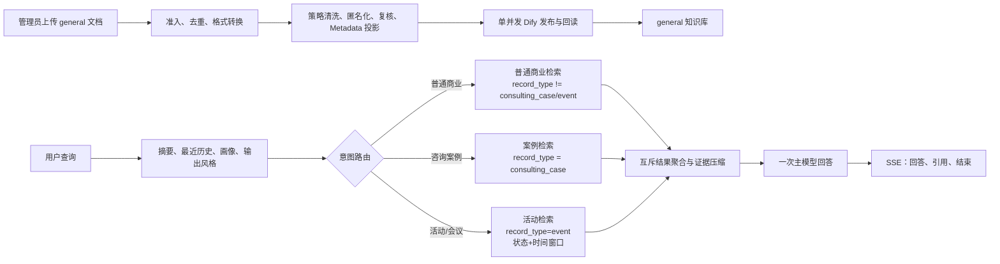

# AI 商业顾问 RAG 全链路运行规范与执行清单

> 状态：当前有效；按 ADR-036 于 2026-08-16 重写。
> 适用：新建商业顾问聊天、`general` 知识库的清洗入库、Dify 绑定和验收。
> 不授权：清理旧课程/路线数据、Dify 数据集、原始文件，或执行远端发布。
> 运行态边界：2026-08-16 已完成最近活动代码 release 和新版 Dify Chatflow 导入发布；jx 尚未同步新版 App Key，因此最终活动 Chatflow 服务侧验收仍以当前状态交接中的开放项为准。本文件是现行规范与后续执行清单，不替代运行态证据。

## 1. 结论与权威

本文件替代旧版“顾问库 + 课程库 + 课程/学习路线推荐”的 RAG 执行计划。旧计划中的课程路由、课程 Metadata 过滤、路线确认、课程卡片、课程 SSE、双库性能比较与课程评测指标，不适用于新建商业顾问聊天。

权威顺序：用户当前确认的规则和 [ADR-036](docs/V2决策记录.md) → [商业顾问移除课程与学习路线改造记录](docs/商业顾问移除课程与学习路线改造记录.md) → 本文件 → 清洗、Dify、接口和运行资料。历史课程资料只在旧数据或受控管理兼容范围内保留，不能反向改变本规范。

当前已验证的设计事实：

- 新聊天只使用一个 Dify 通用知识库 `general`；不读取课程库、不向 Dify 注入课程目录或路线进度，也不读取课程/路线 Redis 或数据库。
- 正常问题只走“普通商业知识”“明确咨询案例”或“明确活动/会议”检索之一；三条路径互斥，随后统一压缩证据并只调用一次主模型。
- 普通/案例路径仍以 `record_type` 为硬过滤；最近活动路径额外使用动态 `record_type=event`、`event_status` 和时间戳区间条件。`topic`、`industry`、`business_stage` 会被部分策略写入 Dify，但当前不将它们作为动态查询条件。
- 课程/路线推荐决策、课程卡片、课程推荐说明及三种课程 SSE 事件均不在新聊天链路中；历史/管理接口仅为兼容保留。
- RAG 质量、延迟和并发仍受 Dify、重排、模型、网络和下游限流影响。没有黄金集和并发实测时，不承诺固定倍率或固定召回指标。

## 2. 当前全链路



### 2.1 查询前上下文

当前商业顾问 DSL 只接收四个 Start 输入：

| 输入 | 用途 | 不包含 |
|---|---|---|
| `conversation_summary` | 已确认且已摘要的会话事实 | 课程/路线状态 |
| `recent_history_text` | 有界的最近对话 | Dify 会话 ID、课程目录 |
| `profile_json` | 已确认的用户画像 | 用户未表达的经营事实 |
| `business_output_style` | 输出风格 | 推荐决策或课程数据 |

会话列表与历史消息为重新签名、重渲染旧课程消息仍可能读取课程目录快照；它不属于新聊天请求路径，也不能被表述为“所有商业顾问接口零课程读取”。

### 2.2 Dify 工作流

受控源文件是 `dify/商业顾问（当前使用版本）.yml`。当前工作流保留一个主 LLM `combined_response_general`，并包含普通、案例和活动三条互斥检索路径、结果聚合、证据压缩、固定即时提示和最终 Answer。

- `quick_route`、`case_route` 是工作流节点名，不是学习路线。
- 正常检索路径只有一个 LLM，主模型不启用重试；`progress_answer` 只降低感知等待，最终回答才写入助手历史。
- 活动路径只有在查询明确包含活动/会议实体和列表、状态或报名意图，且不是“如何/策略/方法”等分析问题时进入。正常活动由中国时区“现在～未来 30 天”的动态时间窗口筛选；取消/延期只按明确状态筛选，延期未定不伪造时间。
- 证据不足时可以直接回答，但不得捏造“知识库依据”，不得把案例判断说成普遍规律。
- 不得推荐、比较、介绍或展示课程；服务端也不生成课程/路线结构化结果。

## 3. `general` 知识库的正式清洗策略

测试页和策略发现固定使用 `general`。下表只列新商业顾问可使用的策略；课程策略虽为历史/管理兼容保留，但不属于本文件的入库、检索、性能或验收范围。

| 策略 | 主要输入 | 内容与分条规则 | Dify 业务 Metadata allowlist |
|---|---|---|---|
| `standard_document` | Markdown、TXT、DOCX、PDF | 安全通用清洗；当前测试页固定投放 `general` | `document_type`、`review_status` |
| `wechat_public_account_cognition` | TXT | 公众号认知/商业知识，可拆为多篇逻辑条目 | `record_type=article`、`topic`、`source_title`、`industry`、`business_stage` |
| `zsxq_post` | Markdown | 知识星球帖子，可拆为多篇逻辑条目 | 同上 |
| `xiaobot_post` | Markdown | 小报童帖子，可拆为多篇逻辑条目 | 同上 |
| `lead_magnet` | Markdown、TXT、DOCX、PDF | 资料钩子，保留可核验的商业内容 | 同上 |
| `book` | Markdown、TXT、DOCX、PDF | 书籍；超大内容按策略拆分 | `record_type=book`、`topic`、`source_title`、`book_id`、`part_index`、`part_count` |
| `personal_business_consultation` | Markdown、DOCX、PDF | 匿名完整咨询案例；背景、约束、诊断、方案、结果保持对应 | `record_type=consulting_case`、`topic`、`source_title`、`case_id` |
| `recent_activity` | Markdown、TXT、DOCX | 一个活动一个逻辑条目；状态和时间事实严格解析，语义分类使用实时千问 | `record_type=event`、`event_id`、`event_status`、`source_status`、`event_type`、`topic`、`industry`、`business_stage`、`delivery_mode`、`city`、`event_start_ts`、`event_end_ts`、可选 `registration_deadline_ts`、`registration_url`、`source_title` |

`test_markdown` 仅用于链路验证。`raw` 上传会做统一格式转换和表格清洗，但不执行策略级语义、匿名化或内容模型处理，不是商业顾问的受控知识生产路径。

### 3.1 内容、隐私与复核边界

- 可以删除无语义填充、重复页眉页脚、目录正文、会务噪声、无信息增量重复和明确 OCR 乱码。
- 必须保留数字、时间、主体、否定、因果、适用条件、反例、风险，以及“计划/假设/建议”和“已发生事实”的区别。
- 文章/帖子按已识别结构拆为独立逻辑条目；每个条目独立成为本地条目及一个 Dify 文档，不能拼接多篇正文。
- 咨询案例入库前必须匿名化。不得把背景、约束、诊断、方案和结果拆成可跨案例拼接的无主事实。
- PDF/DOCX 先转内部 Markdown；最终正文必须通过表格清洗与无 Markdown/HTML 表格门禁。转换、OCR、模型或复核的细节以 [清洗策略接入说明](docs/清洗策略接入说明.md) 为准。
- 新批次的内容模型异常在存在非空、已完成基础门禁的源 Markdown 时，可按既有降级规则继续发布；空正文、隐私风险、转换失败或 Dify 硬校验失败不得伪造成功。

### 3.2 发布、状态与去重

1. 服务端冻结策略、知识库、公共 Metadata、分块参数与复核策略快照。
2. 通过格式、容量和“同名或同内容”去重后，生成 `CleaningFile`、`CleaningDocument` 和本地审计记录。
3. 每个逻辑条目独立调用 Dify `create-by-text`；返回的 `batch` 只代表该文档的异步索引，不是多文档创建接口。
4. 普通 Dify 写入统一进入 `ai_publication` 单并发 Worker。不得靠并发创建或拼接正文提升吞吐。
5. 成功同时要求：创建成功、索引终态、父子块结构正确、允许 Metadata 写入并回读。HTTP 200 不是入库成功。
6. 失败、待复核、排除和重复项分别留下可审计状态。重新上传前必须按精确 `file_id` 删除全部关联远端分片并确认去重保护释放；不得按名称模糊删除或直接改数据库。

源文件、转换前 Markdown 和模型产物的保留/删除遵循现有清洗规范及环境配置。本文件不因“更新计划”而授权清理旧课程、旧 Dify 文档或生产资料。

## 4. Metadata 契约、过滤与关键风险

### 4.1 本地完整记录与 Dify 最小投影

本地记录保存来源文件、SHA、批次、策略、构建版本、审计和复核信息，用于管理、去重和精确清理。Dify 接收“策略声明的业务 allowlist”以及受控远端溯源字段 `cleaning_strategy`、`cleaning_spec_revision`、`content_format`；原始文件名、源文件 ID、源 SHA、批次 ID、构建版本、测试页清理标记、人名映射和受保护来源信息不得写入 Dify 自定义 Metadata。

| 字段/字段组 | 当前用途 | 当前是否为检索硬过滤 |
|---|---|---|
| `record_type` | 区分普通资料、书籍和咨询案例 | 是，但仅筛选 `consulting_case` |
| `event_status` | 活动状态：`normal`、`cancelled`、`postponed` | 是，仅在活动意图分支中按用户请求状态筛选 |
| `event_start_ts`、`event_end_ts` | 活动时间窗口相交判断 | 是，仅正常活动分支使用动态数值条件 |
| `topic`、`industry`、`business_stage` | 部分文章策略的内容治理及未来候选字段 | 否，当前不按用户问题动态过滤 |
| `case_id`、`book_id`、分片序号 | 关联、审计、管理和内容定位 | 否 |
| `source_title` | 受控引用或管理显示 | 否；不能反推原始文件名或身份 |
| `document_type`、`review_status` | 通用文档策略状态 | 否 |
| 原始文件名、文件 ID、SHA、批次、审计、人名映射 | 本地安全追踪 | 否，且不得公开或写入 Dify 自定义 Metadata |

调用方的 `common_metadata` 受服务端白名单限制，系统来源字段最终写入且不能被调用方覆盖。新增字段、改变远端投影或把可选字段变成查询条件，都属于新的产品/DSL/数据设计变更，必须先完成需求、回填、Dify 验证和回归测试。

### 4.2 当前 Dify 检索过滤

| 节点 | 数据集 | Metadata 条件 | 固定检索参数 |
|---|---|---|---|
| `general_knowledge` | `general` | `record_type is not consulting_case` 且 `record_type is not event` | `top_k=5`，`qwen3-rerank`，阈值 `0.3` |
| `case_knowledge` | `general` | `record_type is consulting_case` | `top_k=5`，`qwen3-rerank`，阈值 `0.3` |
| `activity_knowledge` | `general` | `record_type=event`、动态 `event_status`；正常状态再要求 `event_end_ts ≥ start_ts`、`event_start_ts ≤ end_ts` | `top_k=20`，`qwen3-rerank`，阈值 `0.2` |
| `activity_status_knowledge` | `general` | `record_type=event`、动态 `event_status`；供取消/延期分支使用 | `top_k=20`，`qwen3-rerank`，阈值 `0.2` |

活动条件中的时间窗口和状态来自当前运行时 Code 节点变量；Dify 1.13.3 的动态 Metadata 变量、数值比较和 `doc_metadata` 读取已完成隔离验证与静态契约校验。旧计划中的“按行业/阶段/主题生成过滤、零召回后放宽条件再检索”当前没有实现，不得写入产品承诺、验收或运行手册。

数据隔离是必要前提：普通节点排除 `consulting_case` 和 `event`。若课程资料误入 `general`，且其 `record_type` 不是这两类值，仍可能被普通检索召回并通过 `retriever_resources` 暴露线索。必须依靠正确策略、目标知识库和精确数据清理防止污染，不能假设 DSL 会自动识别课程资料。

### 4.3 咨询案例 `record_type` 兼容门禁

当前 DSL 只精确匹配 `consulting_case`。仓库另有较新的咨询模型路径会写入 `consulting_case_v2`；现有 DSL 未验证该值会被案例节点检索。因此，不能宣称任何“v2 咨询案例”均可被当前商业顾问召回。

新案例入库前必须确认实际发布路径及 Dify 回读的 `record_type`：

- 若目标是当前案例检索，必须证明远端值为 `consulting_case`；或
- 先以独立需求评审 DSL 过滤兼容、历史数据迁移、回滚和回归测试。

在完成其中任一项之前，`consulting_case_v2` 只能视为未验证的数据兼容风险，而不是自动可用的 RAG 内容。

## 5. 查询、SSE 与公开隐私边界

`POST /internal/v1/business/chat` 的请求字段保持不变。工作流仅在用户明确索要相关、类似或真实咨询案例时走案例检索；明确查询最近/取消/延期活动时走活动检索；其他正常商业问题走普通检索。三条检索不并行，不访问课程库，之后聚合、压缩证据，再调用一次主模型。

当前新聊天 SSE 只允许：

```text
request_started
status
answer_delta
retriever_resources
message_end
error
```

`status` 可标识即时提示和最终回答的边界。`learning_route`、`course_cards`、`course_recommendation_note` 不得由新聊天发送；小程序后端不得等待或渲染这些事件，`entry-config.business_advisor.course_recommendation=false`。

公开数据最小化规则：

- 回答、SSE 引用和历史消息不得泄露真实姓名、昵称、笔名、联系方式、精确公司名、账号、合同信息、原始文件名或受保护映射。
- `retriever_resources` 是通用引用事件，不是课程功能恢复；其存在使通用库的数据隔离成为发布前检查项。
- 历史课程/路线消息的兼容读取不能成为新回答的知识来源。

## 6. 新数据执行清单

### 6.1 入库前

- 确认目标是 `general`，并选择与来源相符的正式策略。
- 确认具有处理权限；咨询资料先确定匿名化范围和可保留的行业、规模、阶段、约束信息。
- 不将课程/学习路线资料上传至 `general`；旧课程资料清理由业务方按精确记录另行授权。
- 确认 Dataset 已具备策略需要的 Metadata 字段；来源追踪字段不得被当作公开检索字段。
- 对新咨询案例完成 `record_type` 兼容门禁，不能只看本地清洗结果。
- 真实样本、Dify 写入和远端操作按既有鉴权、备份、清理清单和授权范围执行。

### 6.2 发布后

- 核验每条成功记录的 Dify 创建、索引终态、父子块数量和允许 Metadata 回读。
- 抽检普通文章/书籍的关键条件、反例和数字没有改变；抽检案例的背景—约束—方案—结果没有错配。
- 用受控样本验证普通检索不返回 `consulting_case`，案例检索不返回非案例资料；正式案例召回质量需另留有召回证据。
- 核验正文、SSE 引用和历史消息未出现受保护来源信息或课程/路线事件。
- 失败或待复核按状态处理；不得为了提高成功率跳过隐私门禁、Dify 回读或精确删除要求。

## 7. 验收、性能与变更门禁

### 7.1 本地检查面

以下是本规范的最小相关检查面；实际执行命令按仓库质量配置和变更范围确定：

- `tests/test_business_advisor_unified_dsl.py`：四个 Start 输入、普通/案例/活动互斥路径、动态窗口和聚合边界、单 LLM、无课程节点。
- `tests/test_activity_cleaning.py`、`tests/test_dify_activity_contract.py`：活动状态、日期推断、延期未定、Metadata 类型和动态条件契约。
- `tests/test_business_advisor_optimized_dsl.py`：`record_type` 静态过滤、重排、阈值、结果聚合及无主模型重试。
- `tests/test_ai_management.py`、`tests/test_app_routing.py`：新聊天的课程/路线零访问、SSE 与历史兼容。
- `tests/test_cleaning_strategy_visibility.py`、`tests/test_consultation_rag_integration.py`、`tests/test_model_cleaning_workflow.py`、`tests/test_unified_document_pipeline.py`：策略可见性、案例 Metadata、清洗、复核和发布边界。
- `scripts/build_business_advisor_unified_dsl.py --check`、`scripts/dify_contract_check.py`、`scripts/jx_rag_regression.py` 与 `scripts/generate_project_index.py --check`：受控 DSL、Dify 契约、RAG 回归和工程索引。

### 7.2 Dify/jx 运行态验收

每次变更 DSL、App Key、知识库绑定、清洗远端投影或发布脚本时，不能只以本地 YAML/单测作为完成依据。至少核验：

1. Dify 导入、检查和发布成功；`variable-aggregator` 下游读取实际 `output`。
2. `/parameters` 恰为四个商业顾问 Start 输入。
3. 新建普通商业查询和明确案例查询均以 `message_end.status=completed` 结束；对正式案例必须补有召回的验收证据，不能把空 Dataset smoke 当成 RAG 质量通过。
4. 活动查询分别覆盖正常、取消、延期（含延期未定）和普通活动分析负例；正常结果按时间排序且不混入取消/延期，延期未定不伪造旧时间。
5. SSE 不出现课程、路线或课程卡片事件，也不泄露敏感来源。
6. AI 管理服务 `health/ready`、Dify 可达性和读取新配置的服务重建状态均通过。
7. 写入型验收只用精确 ID 或测试标记清理，并联合复核知识库、本地状态、Redis 和上传目录；不按名称正则或整库清理。

### 7.3 尚待黄金集决定的指标

当前没有可冻结的“课程/顾问路由准确率”“课程 Top-K 召回率”或双库并发对比目标。若要量化优化，应先以脱敏、可复现的黄金集覆盖普通商业、明确案例、无关问题、零召回和 `record_type` 兼容，再记录：

- 检索资源类型正确率、案例隔离率、零召回率、引用泄露率和有召回案例的答案忠实性；
- P50/P95 首 Token 与总耗时、错误率、吞吐量、Dify/模型限流和上下文 token；
- 清洗成功率、复核率、源 Markdown 降级率、Dify 索引与 Metadata 回读失败率。

新增动态 Metadata 过滤、自动放宽重试、第二知识库或并行检索，都会改变召回边界、并发成本和可解释性，必须作为独立需求评审，不得借用本规范默认上线。

## 8. 发布、回滚与兼容边界

- Dify 的唯一受控商业顾问导入源是 `dify/商业顾问（当前使用版本）.yml`。完整 wheel 发布不会自动发布 Dify 应用，也不得把旧课程/路线 DSL 或 Prompt 安装为当前资产。
- 回滚同时恢复 AI 管理服务版本、已发布 Dify 商业顾问应用和必要的 App Key 映射，再复测 `health/ready`、`/parameters`、普通/案例 SSE。只还原本地 DSL 文件无效。
- 不直接修改 Dify 业务数据库、不在容器内热改代码、不删除持久卷，也不以整库 Redis 清理代替回滚。
- 课程/路线的历史消息、管理、显式上传与跳转接口仍按各自规范保留；它们与本文件的新聊天 RAG 没有数据读取或输出依赖。

## 9. 相关资料

- [ADR 与当前边界](docs/V2决策记录.md)
- [商业顾问移除课程与学习路线改造记录](docs/商业顾问移除课程与学习路线改造记录.md)
- [清洗策略接入说明](docs/清洗策略接入说明.md)
- [Dify 创建、导入、绑定与契约测试](docs/Dify创建导入绑定与契约测试.md)
- [API 与 SSE 说明](docs/API与SSE说明.md)
- [当前状态与后续测试交接](AI管理服务当前状态与后续测试交接.md)
