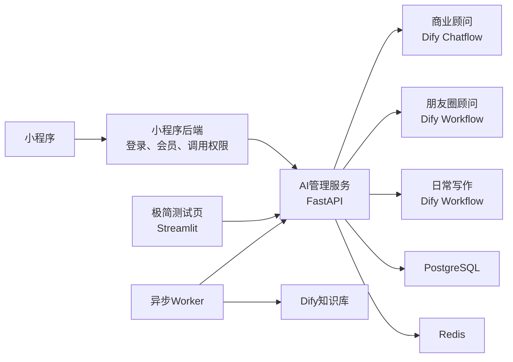

# AI 管理服务快速落地与测试计划

> 当前服务器部署结果、已验证事项和后续测试顺序，请先阅读  
> [AI管理服务当前状态与后续测试交接.md](AI管理服务当前状态与后续测试交接.md)。

> 状态：已确认，按阶段开发与验证  
> 最后调整：2026-07-23

> 实现说明：本文件继续作为业务执行基线。已经落地的代码、数据库迁移、四份 DSL、Prompt、测试数据和运行说明见 [README.md](README.md)；更细的边界与实现映射见 [需求与产品边界](docs/需求与产品边界.md)、[服务开发与数据设计](docs/服务开发与数据设计.md)、[API与SSE说明](docs/API与SSE说明.md) 和 [Dify创建导入绑定与契约测试](docs/Dify创建导入绑定与契约测试.md)。  
> 环境门禁：本地自动测试通过不代表 Dify 契约、RAG 指标和20并发已经通过；这些项目必须使用目标 Dify 1.13.3、真实 Key、Dataset ID 和模型额度执行后再勾选。

## 1. 最终架构与边界

只建设一个模块化 **AI 管理服务**，不单独拆 AI 网关。



- 小程序后端继续负责用户身份、会员和是否允许调用 AI。
- AI 管理服务负责 Dify 代理、商业顾问多会话、摘要、商业画像、课程推荐、点击统计、清洗编排和统一错误。
- Dify 负责模型、Prompt、Chatflow/Workflow、知识检索、消息反馈和详细运行日志。
- PostgreSQL 保存不能丢失的事实；Redis 用于缓存、短期状态、锁和任务队列。
- 使用模块化单体；API、上下文 Worker、清洗 Worker 同仓库分进程运行。

## 2. 三个入口

| 入口 | Dify 类型 | 历史/续聊 | 摘要 | 用户画像 | 课程推荐 |
|---|---|---:|---:|---:|---:|
| `business_advisor` | Chatflow | 是，多会话 | 是 | 仅商业画像 | 是 |
| `moments_advisor` | Workflow | 否 | 否 | 否 | 否 |
| `writing_advisor` | Workflow | 否 | 否 | 否 | 否 |

- 商业顾问的一个本地对话对应一个 Dify `conversation_id`；新建对话不传 ID，历史续聊复用该对话的 ID。
- 朋友圈和日常写作每次都是独立 Workflow 运行，不接受 `conversation_id`，不创建历史、摘要或画像。
- Dify 控制台继续管理模型、Prompt 和知识库；另建极简测试页，通过 AI 管理服务验证完整链路，测试页不得直连 Dify。

## 3. 商业顾问上下文

Chatflow 定义会话变量：

```text
local_conversation_id
conversation_summary
profile_json
route_progress_json
```

- 首轮通过 `inputs` 初始化；后续使用 Dify 会话变量查询/更新 API，不依赖后续 `inputs` 覆盖。
- 商业画像是用户级事实；当前对话立即同步，其他旧对话在下次使用前按 checksum 懒同步。
- Dify Memory 保留最近 3 个完整问答轮次。
- 未摘要内容达到 6 个用户轮次或约 3000 token 时异步摘要；摘要时保留最近 3 轮。
- 摘要 Worker 保存 `summary_through_message_id`，旧任务不得覆盖更新摘要。
- 同一对话禁止并发发送，繁忙时返回 `409 CONVERSATION_BUSY`。
- 历史默认保留 7 天，可配置。

开发前必须用实际 Dify 1.13.3 验证会话变量、历史、反馈、父子分段、Metadata 和索引状态。若部署实例的会话变量更新不可用，备用方案才是 Chatflow HTTP 节点按本地会话 ID 读取最新上下文，不能通过反复新建对话解决。

## 4. 课程资料与推荐

老板提供的课程名称、方向、主要内容/解决问题和链接，可以支持精确查询及基础直接推荐。完整个性化推荐和路线推荐还需：

- 课程状态、适合人群、前置条件、学习结果。
- 已审核的标准路线、路线目标、阶段、阶段课程 ID 和顺序。
- 同一课程可处于不同路线的不同阶段，因此阶段和顺序以路线文档为准。

AI 只允许从课程介绍、讲义、字幕或逐字稿中提取待审核草稿，不得自动创建课程、链接、正式路线、课程顺序和前置关系。AI 草稿使用 `review_status=pending_review`，人工确认成为 `approved` 后才允许发布。

导入时计算能力：

```text
queryable
direct_recommendable
personalized_recommendable
route_recommendable
```

- 缺课程名称、方向、内容/解决问题、正式链接或状态：禁止正式入库。
- 缺适合人群：不允许声称高度适合该用户。
- 缺前置条件：允许展示，但必须说明资料未提供。
- 缺学习结果：不生成确定性的专家见解。
- 没有审核通过的标准路线：只能推荐单门课程，不能生成“官方路线”。
- 没有课节或时间戳资料：不能编造精确学习位置。

推荐链路：模型理解需求并输出候选 `course_id/route_id` 和解释，AI 管理服务再使用 Redis 当前课程快照校验 ID、状态和能力，补全正式名称与链接。模型不得直接决定最终链接或课程状态。

用户明确查询某门课程时不强制使用画像；目标模糊时先补全必要画像，再选择老板提供的标准路线。用户可保存多条路线，阶段推进只接受用户明确确认。

## 5. 数据与缓存

最小 PostgreSQL 表：

- `business_profile`：确认画像与候选画像。
- `business_conversation`：本地/Dify 会话映射、摘要游标、过期时间。
- `learning_route_progress`：用户确认的路线和当前阶段。
- `course`、`learning_route`：结构化课程和路线事实，复杂字段使用 JSONB。
- `course_click_event`：点击和去重人数统计。
- `cleaning_batch`、`cleaning_file`、`cleaning_document`：清洗批次、终态和 Dify 映射。

一致性规则：

- 画像、摘要和路线进度先写 PostgreSQL，再更新/删除 Redis 缓存。
- 课程批量更新完成后原子替换 Redis 快照。
- 点击可以先缓存在 Redis，定时批量落库。
- 清洗中间阶段写 Redis；创建记录和最终状态写 PostgreSQL。
- Redis RDB 快照可能丢失最近写入，不能把核心事实只存 Redis 等夜间再落库。

## 6. 文件清洗

复用现有 `knowledge_cleaner` 的解析、匿名化、父子分块、Dify 发布、Metadata、失败补偿和评测，不从零重写。

策略只在代码中注册，不建立策略表和动态后台：

```python
STRATEGY_REGISTRY = {
    "test_markdown": TestMarkdownStrategy(),
    # 正式策略拿到规则和样本后接入
}
```

- 一批文件只能选择一种策略，每个文件独立处理。
- 文件状态：`pending/processing/succeeded/failed`。
- 阶段：`upload/cleaning/dify_upload/dify_indexing/metadata`。
- Dify 创建成功不代表入库成功；必须等待索引完成、分块数大于 0 并成功设置 Metadata。
- 一个原文件产生的全部 Dify 文档成功后，文件才算成功。
- 失败自动重试一次；再次失败进入终态并保留失败阶段和原因。
- 成功临时文件立即删除，失败文件保留 24 小时，Redis 终态保留 7 天。

名称：

- `original_filename`：规范化完整原名，仅用于展示和追踪。
- `storage_filename`：`{file_id}.{extension}`。
- `dify_document_name`：`缩短主名__SHA256前8位__序号.md`。
- 敏感策略只向 Dify 写匿名名称和 `source_file_id`。

## 7. 接口

商业顾问：

```http
POST   /internal/v1/business/chat
POST   /internal/v1/business/chat/{task_id}/stop
GET    /internal/v1/business/conversations
GET    /internal/v1/business/conversations/{conversation_id}/messages
PATCH  /internal/v1/business/conversations/{conversation_id}
DELETE /internal/v1/business/conversations/{conversation_id}
POST   /internal/v1/business/messages/{message_id}/feedback
```

无状态工具：

```http
POST /internal/v1/tools/moments/run
POST /internal/v1/tools/writing/run
POST /internal/v1/tools/{task_id}/stop
```

其他：

```http
GET  /internal/v1/entry-config
GET  /r/{opaque_token}
POST /internal/v1/course-catalog/validation-batches
GET  /internal/v1/course-catalog/validation-batches/{batch_id}
POST /internal/v1/course-catalog/validation-batches/{batch_id}/publish
GET  /internal/v1/knowledge/cleaning-strategies
POST /internal/v1/knowledge/cleaning-batches
GET  /internal/v1/knowledge/cleaning-batches/{batch_id}
POST /internal/v1/knowledge/cleaning-batches/{batch_id}/files/{file_id}/retry
GET  /health/live
GET  /health/ready
```

统一 SSE 事件：`request_started/status/answer_delta/course_cards/learning_route/expert_insight/message_end/error`。无状态工具不返回课程、路线或业务会话 ID。

## 8. 安全与可观测性

- 阿里云安全组/白名单加简单 `X-Internal-Token`；同一 VPC 不等于只有小程序后端能够访问。
- Dify API Key 只保存在服务端；传给 Dify 的 `user` 使用 HMAC 生成稳定匿名标识。
- 上传默认每批 10 个、单文件 50MB，可配置；同时校验扩展名、MIME、文件头和路径。
- JSON 日志记录 `request_id`、哈希用户、场景、任务/会话 ID、耗时和错误阶段，不默认记录完整内容及敏感文件名。

## 9. 极简测试页

现有 Streamlit 页面改为只调用 AI 管理服务，包含：

1. 商业顾问：新建/选择历史、续聊、停止、反馈、课程和路线展示。
2. 朋友圈顾问：单次输入与流式结果，验证无历史。
3. 日常写作：单次输入与流式结果，验证无历史。
4. 课程资料：校验缺失字段、推荐能力、路线引用并发布测试资料。
5. 文件清洗：策略、批量上传、状态、失败原因和重试。
6. 诊断：请求 ID、Dify 任务/会话 ID、首 Token/总耗时、上下文同步状态和错误。

## 10. 测试和验收

- 单元测试：SSE、Dify错误、画像合并、摘要游标、课程校验、路线引用、文件名、策略、点击 Token。
- Dify契约测试：会话变量、Workflow、反馈、父子分段、索引、Metadata、中文/超长名称。
- 业务集成：多用户多对话不串数据；旧对话同步新画像；无状态工具无记忆；无效课程、链接和路线不输出。
- RAG 首批 40 条黄金问题；关键问题 `Hit@5 >= 90%`，全量 `Recall@5 >= 80%`，引用完整率 `>= 90%`，无依据回答率 `<= 5%`，错误课程 ID、链接和虚构路线为 0。
- 首版验证 20 个并发流式请求；AI 管理服务自身新增开销目标 `p95 < 200ms`（不含模型生成时间）；同一对话并发稳定返回 409。

## 11. 实施阶段与门禁

1. 更新需求、产品、API、开发、Prompt 和测试文档；修复普通 `pytest -q` 测试发现。
2. 验证实际 Dify 1.13.3 契约。
3. 建立 FastAPI、配置、鉴权、PostgreSQL、Redis、Worker 和统一错误。
4. 完成商业顾问多会话、历史、流式、停止和反馈。
5. 完成摘要、商业画像和多路线进度。
6. 完成课程校验、发布、直接推荐、路线推荐、卡片和点击统计。
7. 完成朋友圈和日常写作无状态 Workflow。
8. 改造极简测试页。
9. 将现有清洗器封装成在线批量清洗流程，再按真实样本接入正式策略。
10. 完成 RAG、异常、并发、灰度和上线检查。

每阶段测试通过后才能进入下一阶段。

## 12. 第一版明确不做

- 独立 AI 网关微服务或完整运营后台。
- 自研模型、Prompt、知识库编辑器或 RAG 平台。
- 清洗策略表、动态插件平台和通用 ETL。
- 朋友圈/写作历史、摘要和画像。
- AI 自动发布未审核课程、创建正式路线或编造链接。
- 逐门课程学习进度和复杂缓存版本/人工回退平台。
