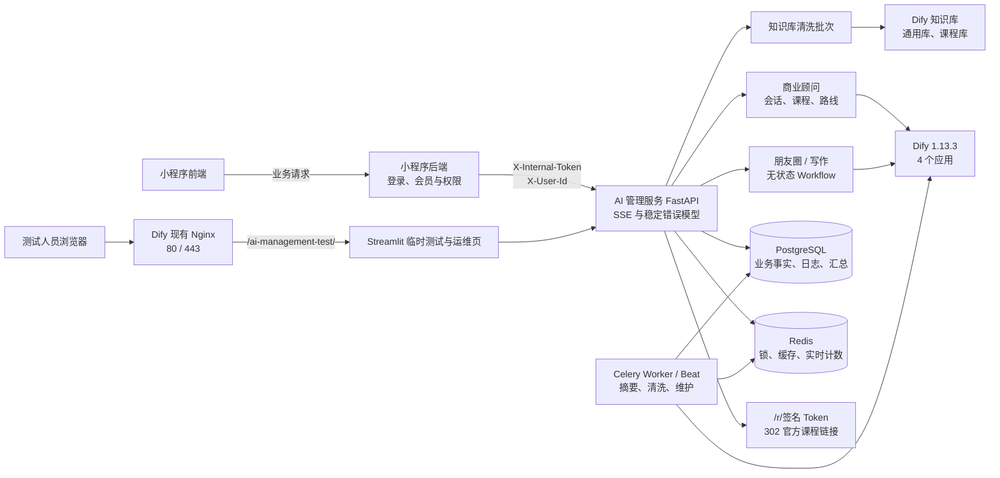

# V2 全链路交接文档（2026-07-27）

> 读者：后端开发、Dify 维护人员与运维人员。  
> 基线：本文件描述当前仓库和 jx 测试服务器的实际状态；历史计划、旧手册仅作背景。密钥、密码、真实用户数据和 `.env` 内容均不应写入本文件或提交版本库。

## 1. 当前结论与证据口径

当前 jx 测试服务器已运行以下版本：

- 核心服务（API、Worker、Scheduler）：`jx-now-ai-management:0.2.0-c499193`。
- 测试与运维界面：`jx-now-ai-management-ui:0.2.0-3cfa83c`。
- 数据库迁移：`8d4e0f2c1a77 (head)`。
- API `/health/live`、`/health/ready` 和 Streamlit HTTP 检查均通过；ready 中 PostgreSQL、Redis、Dify 应用、知识库配置和 Dify 连通性均为 true。

证据必须分三类阅读：

| 分类 | 含义 | 当前例子 |
| --- | --- | --- |
| 已验证 | 本次发布或核验有明确结果 | 镜像版本、迁移、健康检查、后台双 Token、JSON 日志、Streamlit 通过 Dify 现有 Nginx 路径发布。 |
| 历史验收记录 | 已写入检查点，但原始报告未全部保存到仓库 | 43/43 离线测试、40 条 RAG、6 条业务 E2E、真实会话生命周期。 |
| 待验证 | 尚未形成当前可复核证据，不应宣称已验收 | 清洗完整 E2E、Worker 重启、20 并发 10 分钟、故障注入、灰度和正式验收。 |

本次服务器发布证据见 [V2部署检查点-2026-07-27.md](V2部署检查点-2026-07-27.md)。

## 2. 全链路与职责边界



### 2.1 小程序与服务的边界

- 小程序前端只调用自身后端；不得获得 `X-Internal-Token`、`X-Admin-Token`、Dify App Key、知识库 Key 或 Dataset ID。
- 小程序后端负责登录态、会员资格、频率限制和业务授权；向本服务传稳定的 `X-User-Id`，并保存内部 Token。
- 本服务将用户 ID HMAC 化后用于本地数据和 Dify user；不把小程序登录 Token 传入 Dify。
- `/r/{token}` 是唯一公开跳转接口。它只接受服务签发的短期签名 Token，验证课程仍启用且已审核后才计数并 302 跳转。
- Streamlit 是测试/运维工具，不是小程序用户界面，也不直连数据库、Redis 或 Dify。jx 测试服通过 Dify 已有 Nginx 的 `/ai-management-test/` 路径访问，复用已开放的 80/443；Streamlit 自身仍绑定服务器 `127.0.0.1:8501`，不新增云安全组或防火墙端口。

### 2.2 四个 Dify 应用

| 应用 | 类型 | 使用方 | 作用 |
| --- | --- | --- | --- |
| `business_advisor` | Chatflow | 商业顾问 | 流式问答、检索、课程/路线候选。 |
| `moments_advisor` | Workflow | 朋友圈入口 | 单次生成，不保存商业会话。 |
| `writing_advisor` | Workflow | 日常写作入口 | 单次生成，不保存商业会话。 |
| `summary_profile` | Workflow | Worker | 汇总历史、提取有证据的用户画像候选。 |

两个知识库分别为通用资料库和课程资料库。Dify DSL 位于 `dify/dsl/`，Prompt 文档位于 `dify/prompts/`；发布时必须保存目标环境导出的 DSL 和哈希，不以本地文件替代线上证据。

## 3. 本次产出及作用

| 产出 | 位置 | 作用 |
| --- | --- | --- |
| API 与 SSE | `ai_management/main.py`、`ai_management/api/routers/` | 对小程序后端提供三入口、会话、课程跳转、健康与运维接口。 |
| 商业会话与摘要画像 | `conversations.py`、`context.py`、`workers/tasks/summary.py` | 保存本地会话；按日关联 Dify 会话段；异步生成摘要和画像。 |
| 课程、路线与点击 | `courses.py`、`course_import.py` | CLI 发布课程/路线；服务端筛选推荐候选；签名跳转与每日 PV/UV。 |
| 清洗编排 | `cleaning.py`、`workers/tasks/cleaning.py`、`knowledge_cleaner/` | 上传、策略、逐文件状态、重试、Dify 索引和补偿删除。 |
| 数据与缓存 | `models.py`、`db.py`、`cache.py`、`migrations/` | PostgreSQL 保存业务事实；Redis 保存锁、缓存、实时点击累计。 |
| 异步和维护 | `workers/celery_app.py`、`workers/tasks/maintenance.py` | Celery Worker；每天 03:30 清理、点击落库、失败任务处理。 |
| 可观测性 | `services/observability/`、后台日志接口 | JSON 容器日志、请求 ID、后台必要操作/错误事件。 |
| 测试与运维界面 | `test_ui.py` | 通过服务 API 测试入口、清洗、点击和日志。 |
| 临时 UI 网关 | `dify/nginx/ai-management-test.location`、`scripts/configure_dify_nginx_streamlit_proxy.py` | 将测试页安全地挂入 Dify 已有 Nginx 的 `/ai-management-test/` 路径；支持幂等启用/移除 include，不新增公网端口。 |
| Dify 与测试资料 | `dify/`、`test_data/`、`scripts/`、`tests/` | DSL、Prompt、课程样本、RAG 黄金问题、契约/E2E/负载脚本。 |
| 发布与回滚资产 | Dockerfile、Compose、服务器备份 | 离线镜像构建、服务编排、数据库/Redis/上传卷备份与镜像回滚。 |

### 点击统计口径（已定稿）

“只保存每日 PV/UV，不增加逐次点击事件表”的意思是：**每次有效课程链接点击都会计入 PV**；同一匿名用户同一课程同日只计一次 UV。Redis 保存当天累计绝对值，定时任务幂等写入 `course_click_daily`。因此后台可以看到课程被点击的总次数，不能回放“某一次点击的逐条明细”。这是为隐私、存储与运维成本作出的范围选择，不是“不统计点击次数”。

## 4. 当前项目结构

```text
jx-now/
├─ ai_management/                 # 服务代码
│  ├─ api/routers/                 # business、tools、entry、admin、health
│  ├─ workers/                     # Celery app、摘要、清洗、夜间维护任务
│  ├─ services/observability/      # JSON 日志与系统事件
│  ├─ conversations.py             # 商业会话核心逻辑（仍较集中）
│  ├─ cleaning.py                  # 清洗路由与策略（仍较集中）
│  ├─ courses.py / course_import.py# 课程、路线、跳转与 CLI
│  └─ test_ui.py                   # Streamlit 测试页
├─ knowledge_cleaner/              # 文档清洗与 Dify 知识库适配
├─ dify/                           # 四份 DSL 与 Prompt
├─ migrations/                     # Alembic 迁移，只追加已评审迁移
├─ scripts/                        # Dify、生命周期、E2E、负载测试脚本
├─ tests/                          # 离线单元、路由、清洗与结构测试
├─ test_data/                      # 合成课程、知识、清洗和 RAG 样本
├─ docs/                           # 设计、交接、测试与运行手册
├─ docker-compose.ai.yml           # 核心服务、PostgreSQL、Redis
├─ docker-compose.ui.yml           # 独立测试界面
└─ Dockerfile*.                    # 离线核心/UI 镜像构建
```

当前已将 API Router、Worker 和可观测性拆出；但 `conversations.py`、`cleaning.py`、课程逻辑仍包含较多业务、存储和外部调用。目标分层结构与迁移顺序见 [项目目录结构.md](项目目录结构.md)，它是后续重构目标而非“已经完全完成”的证明。

应提交源码、迁移、DSL、Prompt、合成测试数据与脱敏验收摘要。不得提交 `.env`、真实 Token/密码、真实用户数据、上传文件、日志、缓存、`var/` 原始报告、`build/`、`dist/`、wheelhouse 或本地数据库。

## 5. 小程序后端接口契约

除健康与签名跳转外，接口都使用 `X-Internal-Token`。用户功能还需要 `X-User-Id`；管理功能额外需要 `X-Admin-Token`。

| 分类 | 方法与路径 | 必需请求头 | 用途 |
| --- | --- | --- | --- |
| 健康 | `GET /health/live`、`GET /health/ready` | 无 | 负载均衡/运维检查；`ready` 失败时不接流量。 |
| 入口 | `GET /internal/v1/entry-config` | Internal | 读取三个入口及 Dify 开场白/推荐问题。 |
| 商业顾问 | `POST /internal/v1/business/chat` | Internal、User | 请求 `{query, conversation_id?}`，返回 `text/event-stream`。 |
| 停止生成 | `POST /internal/v1/business/chat/{task_id}/stop` | Internal、User | 停止商业顾问的 Dify 任务。 |
| 会话 | `GET /internal/v1/business/conversations` | Internal、User | 当前用户会话列表。 |
| 消息 | `GET /internal/v1/business/conversations/{id}/messages` | Internal、User | 当前用户会话消息。 |
| 重命名 | `PATCH /internal/v1/business/conversations/{id}` | Internal、User | 请求 `{title}`。 |
| 删除 | `DELETE /internal/v1/business/conversations/{id}` | Internal、User | 删除当前用户本地会话及关联资源。 |
| 反馈 | `POST /internal/v1/business/messages/{id}/feedback` | Internal、User | 请求 `{rating: like/dislike/null, content}`。 |
| 朋友圈 | `POST /internal/v1/tools/moments/run` | Internal、User | 请求 `{inputs:{request,...}}`，返回 SSE。 |
| 写作 | `POST /internal/v1/tools/writing/run` | Internal、User | 请求 `{inputs:{request,source_text,...}}`，返回 SSE。 |
| 停止工具 | `POST /internal/v1/tools/{task_id}/stop` | Internal、User | 停止朋友圈或写作 Workflow。 |
| 课程跳转 | `GET /r/{signed_token}` | 无 | 计 PV/UV 后 302 到官方课程链接。 |
| 清洗 | `/internal/v1/knowledge/*` | Internal | 查询策略、创建/查询批次、单文件重试；仅管理后端调用。 |
| 管理 | `/internal/v1/admin/*` | Internal、Admin | 会话查看、课程目录、PV/UV、系统事件日志；不得开放给前端。 |

商业顾问 SSE 事件依次可能出现 `request_started`、`status`、`answer_delta`、`retriever_resources`、`course_cards`、`learning_route`、`expert_insight`、`message_end`、`error`。客户端必须按 SSE 空行边界拼接 `event:` 与多行 `data:`，不能把一次网络分片当成完整 JSON。

出现 `error` 时，已收到的 `answer_delta` 只能按“部分内容”展示；出现 HTTP 409 `CONVERSATION_BUSY` 时，应提示用户等待或新建会话。统一错误结构为 `{code, message, request_id, retryable}`，调用方应按 `code`、HTTP 状态和 `retryable` 处理，不解析 Dify 原始报错文本。完整字段以 `/openapi.json` 和 [API与SSE说明.md](API与SSE说明.md) 为准。

## 6. 已完成、待完成与改进优先级

### 已完成并有发布证据

- API、Worker、Scheduler、PostgreSQL、Redis、Dify 网络连通和 Streamlit 测试页已部署。AI PostgreSQL 与 Redis 使用独立容器、独立 Docker 卷和专用 DNS 别名 `ai-management-postgres`、`ai-management-redis`；Dify 网络仅用于调用其 API/知识库，不能作为 AI 服务的数据存储。
- Worker/Scheduler 已输出结构化 JSON 应用日志；后台可查询 `SUMMARY_SKIPPED` 等系统事件。
- 三个入口、双 Token 管理接口、课程目录与每日点击汇总已通过服务器复验。
- 已保留数据库、Redis、上传卷、旧 Compose、旧 `.env` 的备份；备份恢复到临时数据库已验证。

### 仍需补齐的验收

1. 使用隔离知识库完整跑通“上传 → 清洗 → Dify 索引 → Metadata → 非零分块 → 失败补偿 → 人工重试”。
2. 验证 Worker 中断/重启、摘要失败、清洗失败和旧 Dify 文档删除失败后的恢复与告警。
3. 执行 20 个不同会话并发 10 分钟，并模拟 Redis、PostgreSQL、Dify 超时/限流。
4. 保存每次 Dify 发布的 DSL 哈希、Dataset/App 绑定快照和脱敏测试报告。
5. 在真实小程序后端完成灰度、用户链路验收和签署的正式验收报告。

### 优化建议

| 优先级 | 建议 | 原因 |
| --- | --- | --- |
| P0 | 将清洗、Worker 恢复、故障注入纳入隔离环境自动 E2E | 这些路径已有实现，缺可复核运行证据。 |
| P0 | 每次发布归档镜像 digest、迁移、命令、脱敏结果和回滚点 | 让“已通过”可追溯，而非只保留口头或摘要结论。 |
| P1 | 将会话、清洗、课程按 `router → service → persistence/integration` 继续拆分 | 降低顶层大文件的维护风险。 |
| P1 | 建立日志平台告警与仪表盘 | 当前有 JSON 日志和后台事件，但没有独立告警闭环。 |
| P1 | 固定 Windows pytest 临时 SQLite 清理流程或改用临时目录/CI PostgreSQL | 避免残留测试进程锁定 `test_ai_management.db` 导致误判。 |
| P2 | 为小程序后端生成 OpenAPI 客户端或契约测试 | 减少手写 SSE/请求模型的接入偏差。 |

## 7. 日常运维注意事项

- API 仅应允许小程序后端和受控运维入口访问；即使处于同一网络也必须校验内部 Token。
- Streamlit 是临时测试/运维界面：Compose 固定绑定服务器 `127.0.0.1:8501`，通过 Dify 已有 Nginx 的 `http(s)://<服务器公网IP>/ai-management-test/` 路径测试，不新增端口或云安全组规则。页面代持内部与管理权限，临时测试期间只使用合成或隔离数据，不在页面输入真实用户内容、文件或生产数据；测试结束按部署手册移除 Nginx 路由。
- PostgreSQL 是业务事实来源；Redis 用于缓存、锁与实时累计，不能凭 Redis 恢复所有业务事实。
- 不要在 `DATABASE_URL`、`REDIS_URL` 中使用通用 `postgres`、`redis` 主机名：AI API 同时连接 Dify 网络，通用别名可能产生跨项目解析歧义。必须使用 `ai-management-postgres`、`ai-management-redis`，并保持 `ai_management_ai_postgres_data`、`ai_management_ai_redis_data` 两个专用卷。
- 容器内不热改源码；每次修改走本地测试、wheel、不可变镜像、备份、发布、验证和回滚流程。
- 管理事件和容器日志不得记录完整用户问题、完整模型回复、真实用户 ID、文件内容、Cookie、Authorization 或任何 Token。
- 每日点击数是业务指标；同一用户重复点击会增加 PV，UV 仅作辅助去重指标，不能解释为学习完成度。
